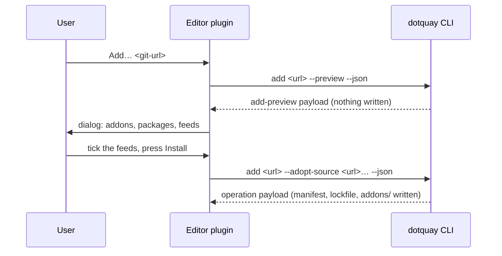

# Design — v0.9: install preview, feed approval in the editor, scene-based UI

Status: **implemented and verified against a real NativeAOT binary**, 2026-08-28.
611 C# tests + 221 GDScript assertions green.

Build recipe and its three environment gotchas: `DESIGN-v0.7-AUTH.md`.

### Verified end to end (native binary, real local git repos)

An addon declaring its own NuGet feed *and* a transitive addon dependency, consumed by a project that
declares no feed:

- **`add --preview`** reported both addons with correct `required_by` attribution, the addon-declared
  NuGet package, and the feed under `sources_needing_approval` — exit code 2, and the manifest,
  lockfile, and `addons/` all untouched afterwards.
- **`--adopt-source <url>`** moved the feed into `sources_to_adopt` with `is_trusted_host: false`
  (per-run approval, not persistent trust), exit code 0.
- **`trusted_hosts`** put the same feed in `sources_to_adopt` with `is_trusted_host: true` and
  `needs_approval: false`.
- **The real add with `--adopt-source`** wrote the attributed `[nuget.sources.vbeami]` block and then
  failed only on the fake feed's DNS — a typed `NuGetSourceException`, not a crash. Without the flag
  it refused and wrote nothing.
- **`AddPreviewJson` serialized correctly from the published binary**, which is the check that
  matters: a payload missing from `DotquayJsonContext` builds and runs fine under JIT and fails only
  in the AOT binary.

## The problem

Two of an `add`'s consequences are invisible from the URL a user typed:

1. **The addons it pulls in transitively.** You ask for one thing and get four folders.
2. **The NuGet feeds those addons declare** (v0.8, SPEC.md §11.3).

At a terminal the second is a console prompt. The editor plugin drives dotquay through captured
stdout and **cannot answer a prompt**, so `--json` uses `DenyAllSourceApproval` — meaning the plugin's
only outcomes were "refuse every feed" or, if we had relaxed it, "adopt blindly". Neither is a
decision the user made.

The first problem is not security-critical but is the more common annoyance, and both are answered by
the same thing: resolve first, show, then commit.

## Decisions

| # | Decision | Alternatives rejected |
|---|---|---|
| D1 | A `--preview` flag on `add`, not a separate `plan` command | A separate command duplicates `add`'s argument parsing and drifts from it; the preview must be resolved from *exactly* the arguments the add will use |
| D2 | The preview is a **real graph walk** that writes nothing | Guessing from the manifest — the plugin would be inventing a dependency list the resolver never confirmed, which is the one thing SPEC.md §18 forbids everywhere else |
| D3 | Approval travels back as `--adopt-source <url>`, repeatable, **per run** | A "yes to everything" flag (the addon may declare a different feed between preview and confirm); writing `trusted_hosts` (approving one addon's feed would silently pre-approve every future addon from that host) |
| D4 | The envelope's `command` is `add-preview`, not `add` | A preview emits `AddPreviewJson` where `add` emits `OperationJson`; one name for two shapes hands the wrong parser a payload it half-reads instead of rejecting |
| D5 | Exit code **2** for "needs approval" | 0 tells a script the add can run unattended when it can't; 1 says the preview failed, which it didn't |
| D6 | `--preview` is git-only, with an explanatory refusal for a NuGet id | Emitting an empty payload the caller has to recognise as meaningless |
| D7 | Every plugin control becomes a `.tscn`, including one scene per repeated row | Keeping the code-built UI — a spacing tweak and a wire-format change would stay in the same review, and the new dialog would have added a third builder |

## The two-phase flow

`PreApprovedSourceApproval` is the seam that carries phase two: an `ISourceApproval` matching an
exact-URL whitelist, case-insensitively — the same identity `SourceAdopter` uses to decide a feed is
already known, because two notions of "the same feed" is how a security boundary becomes a
suggestion.

It **replaces** the console prompt rather than layering in front of it. Falling back to prompting
would re-ask about every feed the user's preview showed and they declined, turning a considered "no"
into a prompt loop.

## Implementation notes

**`DependencyWorkflow` became `partial`,** with the preview in `DependencyWorkflow.Preview.cs`. The
split is worth being able to check at a glance: nothing in that file calls `WriteManifest`,
`WriteLockfile`, or the installer, and a reviewer can confirm the no-write property by reading one
file rather than tracing branches through a 1,800-line orchestrator.

**Two helpers were extracted so the preview cannot drift from the add it predicts:**
`BuildRootSpecs` (the frozen-vs-fresh starting point, previously inline in `SyncAddonGraphAsync`) and
`PrepareAddSpecAsync` (name derivation, the already-declared refusal, and the newest-tag guess). A
preview built from slightly different roots, or picking a different tag, would be a preview of a
different operation — worse than no preview.

**Adoption is evaluated against the *unmodified* manifest.** Trust is a question about what the
project trusts today; the candidate manifest's new `[addons.*]` entry has no bearing on it.

**The preview reuses `DependencyGraphResolver` directly** rather than `SyncAddonGraphAsync`, because
the latter installs addons as it walks. The only thing the preview touches on disk is the throwaway
discovery staging directory the resolver already cleans up after itself.

## The dialog

Rows are marked `+` arriving, `~` moving to a new commit, `=` unchanged, and every row names who
requires it. Unchanged rows are **kept**: a user agreeing to an install wants the shape of the graph,
and silently omitting a diamond's shared corner misrepresents it.

The feed cards state three things, because a URL and a yes/no is not enough to decide with: who is
asking, what the feed would be allowed to serve (`packages` patterns, falling back to the concrete
IDs, mirroring the CLI's own default), and which packages break on a refusal.

**Install is disabled while any feed is unticked.** A refused feed makes the add fail on the CLI side
anyway; letting the user press a button into a guaranteed failure teaches them the dialog is noise.

## Scene conversion

`ui/` is now scenes with bound scripts: the panel, four dialogs, the graph view, the graph node, and
six item scenes under `ui/items/`. Status colours moved from `dependency_node.gd` to
`core/dotquay_palette.gd` — several scenes need the same five colours, and a palette owned by one of
them would make every other scene depend on that one for a reason unrelated to what it draws.

Scripts still build what the data determines. A status row's badges depend on whether the addon is
conflicted, patched, linked, or renamed; no scene can hold a skeleton for every combination.

**`tests/test_scenes.gd` exists because a hand-written `.tscn` fails at load time, not compile time.**
It loads and instantiates every scene, then checks that each `%UniqueName` a script reaches for exists
— with the expected names **scanned out of the script's own source**, so a new `@onready` binding
automatically becomes a checked requirement instead of leaving the test behind. The regex requires an
uppercase first letter, which is what separates a node name from a `%s` format specifier.

One trap found while writing it: `Node.is_node_ready()` is false for anything added to the tree from
`SceneTree._initialize`, because `_ready` has not been reached yet. Asserting on it looked like eleven
broken scenes and was eleven broken assertions.

## Risks

- **The preview costs a full graph walk**, so pressing Add… is now as slow as a resolve. Acceptable:
  it is the same work the add was about to do anyway, and it now happens before the commitment rather
  than after.
- **`update` still has no preview** and still cannot adopt a feed from the plugin, so "Update all"
  will hard-fail on an addon that starts declaring a new feed. `--adopt-source` would close it for two
  lines, but without a preview the user has nothing to approve from. Left deliberately for v0.10.
- **The dialog's per-run approval means repeated re-approval** for a team on a single-host estate.
  That is what `trusted_hosts` is for, and `doctor` already reports it — but the dialog does not
  currently offer to add the host, on purpose (D3).
