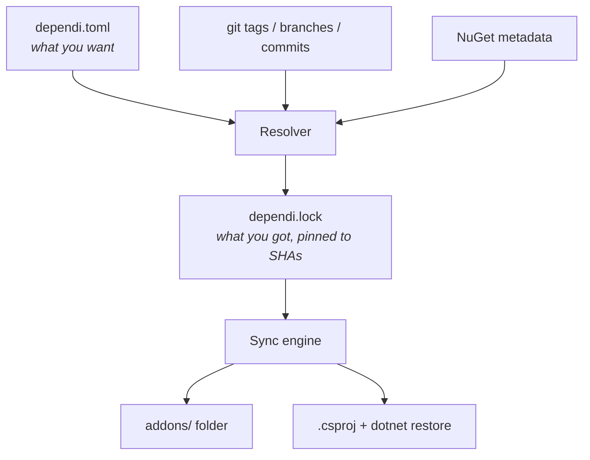
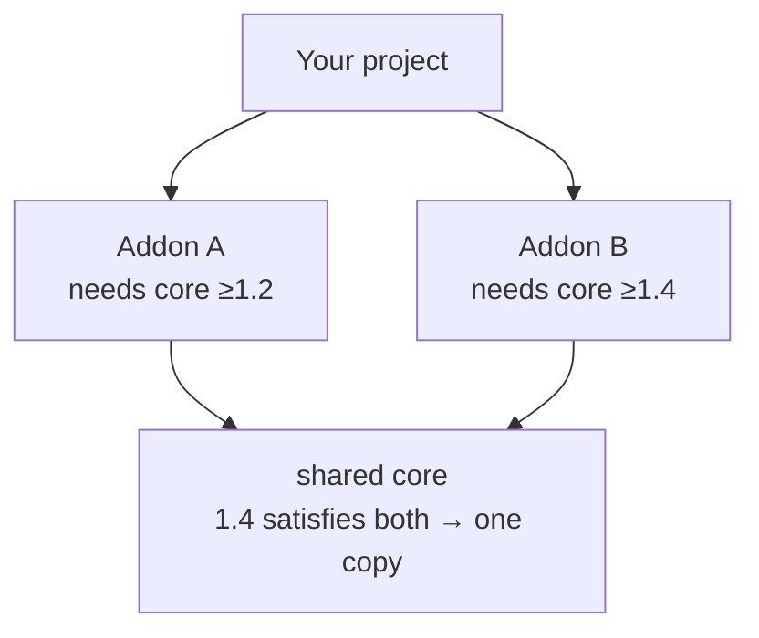
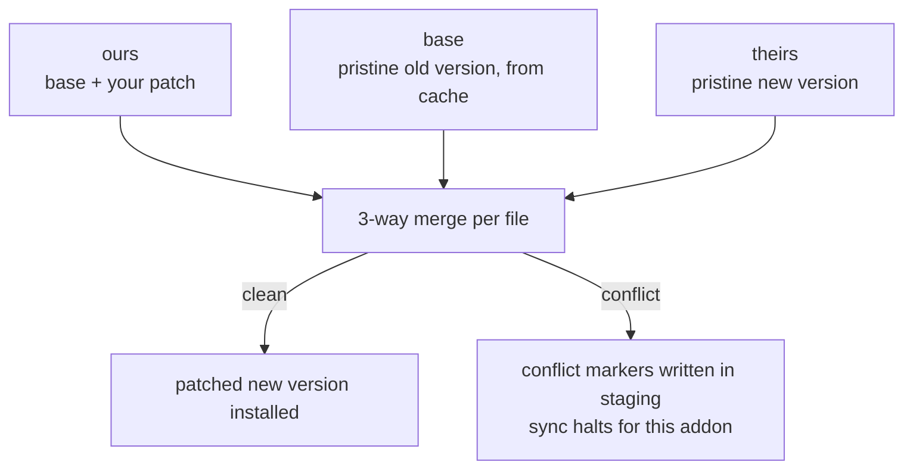

# Dependi — v1 Specification

A package manager CLI for Godot projects. Manages GDScript addons (installed into `addons/`) from plain git repositories and .NET libraries via NuGet delegation, with reproducible installs, safe updates, and patch support.

Status: draft v1 · Author: Kani · Date: 2026-08-21

---

## 1. Problem statement

Godot has no real package manager. Addons live in git repos under an `addons/` subfolder, which makes them unusable as submodules; updating means manually copying folders and hoping the new version didn't delete files; there is no record of which version a project actually uses, so two teammates cloning the same project can end up with different addons. C# projects additionally split their dependencies across NuGet with no unified view.

The cost: broken updates, unreproducible projects, and manual bookkeeping for every addon — multiplied across every project and teammate.

## 2. Goals

1. **Reproducible installs**: a fresh clone plus `dependi install` produces a byte-identical `addons/` folder and identical NuGet references, every time, on every machine.
2. **Safe updates**: updating an addon can never leave stale files behind or silently destroy local modifications.
3. **One manifest for both worlds**: GDScript addons and .NET libraries declared in a single `dependi.toml`.
4. **Works with the ecosystem as it is**: any addon in a git repo is installable — no registry, no author cooperation, no tags required.
5. **Local patches survive updates**: hand-modifications to addons are captured as patch files and re-applied on update with git-grade conflict detection.

## 3. Non-goals

- **Central package registry** — huge separate project; git URLs + NuGet metadata are sufficient sources for v1.
- **Dependency resolution across the unmanaged ecosystem** — third-party addons declare no dependencies, so there is nothing to resolve. Graph resolution exists only for dependi-aware addons (see §8).
- **Godot 3/4 auto-detection** — branch conventions vary per repo; the user picks the branch explicitly.
- **Editor plugin / GUI** — CLI only. A GUI could wrap the CLI later.
- **Godot Asset Library integration** — the asset library lags behind git repos; git is the source of truth. Revisit as a P2 source type.

## 4. User stories

Ordered by priority.

1. As a **Godot developer**, I want to add an addon by git URL and have it appear in `addons/` at the right version, so that I never manually copy folders again.
2. As a **teammate**, I want to clone a project and run one command to get the exact same addons and NuGet packages, so that "works on my machine" disappears.
3. As a **Godot developer**, I want to update one addon (or all) and have old files removed cleanly, so that deleted files in the new version don't haunt my project.
4. As a **Godot developer**, I want to pin addons that never tag releases to an exact commit, so that untagged repos are first-class citizens.
5. As a **Godot developer**, I want to track a `godot4` branch of an addon while my lockfile keeps teammates on the exact commit I tested, so that moving targets stay reproducible.
6. As a **C# Godot developer**, I want NuGet libraries in the same manifest as my addons, so that one tool restores everything.
7. As a **Godot developer**, I want my hand-edits to an addon captured as a patch and re-applied after updates, with conflicts detected like git does, so that patching upstream code is safe.
8. As an **addon author**, I want my addon to declare its own addon and NuGet dependencies, so that installing it pulls in everything it needs.
9. As a **Godot developer**, I want to see which addons are outdated without cloning anything, so that checking for updates is fast.

## 5. How it works — the pipeline

Every operation is a pass through four stages. The manifest says *what you want*; the lockfile records *what you actually got*; the sync engine makes disk match the lockfile — nothing else ever writes to `addons/`.



Key consequence: commands split along the stage boundary.

- `install` reads only the **lockfile** — never picks versions. Reproducible.
- `update` re-runs the **resolver** against the manifest, writes a new lockfile, then installs.

## 6. CLI commands

| Command | Stage | Behavior |
|---|---|---|
| `dependi init` | — | Scaffold `dependi.toml` in the project root |
| `dependi init --package` | — | Scaffold a package manifest (with `[package]` header) inside an addon folder |
| `dependi add <git-url \| nuget-id> [--path <subtree>]` | resolve | Add dependency to manifest, resolve, lock, install. No tags found → pin default-branch tip as `rev` and print a hint. `--path` overrides the default `addons/<name>` subtree guess for repos where the addon folder doesn't match the repo name (§7.1, OQ-2) — added after hitting exactly this against a real repo during Sprint 01 verification |
| `dependi remove <name>` | sync | Remove from manifest, lockfile, and disk |
| `dependi install` | sync | Make disk match lockfile exactly. Errors if lockfile missing entries from manifest |
| `dependi update [name]` | resolve | Re-resolve one or all dependencies, rewrite lockfile, install |
| `dependi list` | — | Show installed dependencies with versions (pseudo-versions for untagged: `0.0.0-20260821-9f2c1ab`) |
| `dependi outdated` | — | `git ls-remote` per repo + NuGet metadata check; compares against lockfile without cloning |
| `dependi status` | — | Diff disk against lockfile hashes: `clean` / `patched as expected` / `modified` |
| `dependi patch <name>` | — | Diff installed addon against pristine cache copy, write `patches/<name>.patch` |
| `dependi doctor` | — | Sanity checks: git on PATH, dangling lockfile entries, `plugin.cfg` version drift, orphaned folders in `addons/` |

### 6.1 `outdated` / `status` / `doctor` implementation notes (v0.2)

`outdated` checks each locked entry against its live upstream without touching disk: `version`- and
`branch`-sourced addons via `git ls-remote` (reusing the same tag-matching logic as the resolver,
just read-only), dotnet packages via a `NuGetVersionSelector.CheckForNewerStableAsync` metadata
query (`NuGetVersion` comparison, not string equality, so normalization differences like `"13.0.3"`
vs. `"13.0.3.0"` don't false-positive). `rev`-sourced addons are skipped entirely — a hard pin has
nothing upstream to compare against. An entry locked but no longer declared in the manifest is also
skipped (that drift is `doctor`'s job, not `outdated`'s).

`status` is purely local: it reuses `DirtyChecker`'s exact content-hash comparison (the same check
install/update already trust before touching an installed addon, requirement P0-6) rather than a
second implementation. In addition to the three states named above, a fourth `missing` state covers
an addon whose folder isn't on disk at all — not a named SPEC state, but common (before the first
`install`, or after a manual delete) and worth reporting distinctly rather than as "clean" or
crashing.

`doctor`'s `plugin.cfg` version-drift check reuses Tomlyn (`Doctor/PluginCfgReader.cs`): Godot's
ConfigFile format for `plugin.cfg` — `[section]` headers plus `key="value"` pairs — is valid TOML for
every real addon surveyed, confirmed against Gut's real `plugin.cfg` during verification, so this
avoids writing a second bespoke parser. Comparison uses `AddonVersion` (the same lenient tag parser
the resolver uses) rather than string equality, and skips addons pinned to a pseudo-version
(`0.0.0-...`, i.e. untagged/rev-pinned) since those have no real upstream release version to compare
against in the first place. The "git on PATH" check is a new `IGitClient.IsAvailableAsync` method
(`git --version`, no network); the "orphaned folders in `addons/`" check needed a new
`IFileSystem.EnumerateDirectories` — the abstraction only had `EnumerateFiles` before.

### 6.2 Patch workflow implementation notes (v0.3)

Three new local git plumbing primitives, behind `IPatchTool`/`ProcessPatchTool`
(`Dependi.Core.Patch`), kept separate from `IGitClient` since none of them touch the network: `git
diff --no-index` (capture), `git apply` (reconstruct "ours" from a patch), `git merge-file`
(per-file 3-way merge). `git diff --no-index dir1 dir2` embeds the literal argument text into its
patch headers, so `DiffDirectoriesAsync` always aliases both sides to fixed one-segment names
(`base`/`ours`, via a real directory copy — not a symlink/junction, which would be Windows-only)
before diffing, making the strip count at apply time (`git apply -p2`) a constant regardless of
where capture and re-application each happen to run. `ApplyPatchAsync` runs with its working
directory set to the target, not `--directory=<target>` — confirmed against real git on Windows that
an absolute, backslash-separated `--directory` value produces `error: invalid path`, while
CWD-based resolution (relying on `-p2` already leaving bare relative paths) is both simpler and
portable.

`dependi patch <name>` (`DependencyWorkflow.PatchAsync`) diffs `addons/<name>` against a fresh
extraction of the pristine cache copy at the locked SHA, writes `patches/<name>.patch`, and records
`patch_hash` (a fingerprint of the patch file's own content) and `patch_base_sha` (the SHA the patch
applies against — tracked separately from `resolved` because it must stay fixed across a clean
`update`, only moving when the user re-runs `patch`). An empty diff clears both fields instead of
writing an empty file. Capturing also recomputes `content_hash` from the current (patched) tree —
without this, the dirty check (P0-6) would refuse every later `install`/`update` of a patched addon,
since `content_hash` would still point at the pre-patch tree forever; caught during real-repo
verification, not by the unit tests, which didn't have real dirty-check plumbing in the loop.

Re-application (`AddonInstaller.InstallAsync`, given the previous `LockedAddon`) reconstructs "ours"
as *the old pristine base plus the patch* (never the currently-installed tree — that keeps the merge
input equal to exactly what `dependi patch` captured) and 3-way merges it against the freshly
extracted new version via `PatchMerger`, per file, across the union of (base, ours, theirs): pure
adds on either side are kept as-is; adds on both sides compare content (identical → clean, different
→ add/add conflict against a synthesized empty base, the same trick git itself uses); deletes are
clean when the surviving side matches base, otherwise a delete/modify conflict that keeps the
surviving side's content rather than silently discarding it; the standard present-in-all-three case
fast-paths on byte-equality (both sides unchanged, or only one side changed) before falling back to
a real `git merge-file` call — sidestepping git's line-based merge for binary files whenever
possible, and correctly falling through to a flagged conflict when a binary file genuinely differs on
both sides. A clean merge overwrites the install's staging tree in place and the swap proceeds
normally, carrying `patch_hash`/`patch_base_sha` forward into the new lockfile entry. A conflicted
merge aborts *before* the swap: `addons/<name>` is left exactly as it was, the conflict-marked merge
result is left in `.dependi/staging/<name>` for inspection, and the lockfile is not rewritten.

Verified against a real local git repository (not just fakes) end to end, both directions: a
hand-edit captured as a patch survives an `update` that also pulls in an unrelated new file from
upstream (clean 3-way merge, `status` reports `patched as expected` afterward); and a hand-edit that
collides with an upstream change to the exact same line produces the expected conflict — exit code
1, conflict markers under `.dependi/staging/demo_addon/`, `addons/demo_addon/` byte-identical to
before the `update` was attempted, lockfile untouched. This surfaced and fixed two real bugs the unit
tests (fakes only) didn't catch: the `--directory` path issue above, and the `content_hash` staleness
issue above.

## 7. File formats

### 7.1 Project manifest — `dependi.toml`

```toml
[project]
godot = "4.3"                     # informational in v1

[addons.dialogue_manager]
git = "https://github.com/nathanhoad/godot_dialogue_manager"
version = "~2.44"                  # matched against git tags
path = "addons/dialogue_manager"   # subtree to extract; default: addons/<name>

[addons.some_addon]
git = "https://github.com/foo/some_addon"
branch = "godot4"                  # track branch tip; lockfile pins the SHA

[addons.other_addon]
git = "https://github.com/bar/other_addon"
rev = "9f2c1ab"                    # hard pin for untagged repos

[dotnet.Newtonsoft.Json]
version = "13.0.*"                 # delegated to NuGet/dotnet restore

[overrides.shared_core]            # project always wins conflicts (§8)
git = "https://github.com/kani/kani_core"
rev = "abc123"
```

Rules: each `[addons.*]` entry names exactly one of `version`, `branch`, or `rev`. `version` requires tags to exist. Whatever the source spec, the lockfile always stores a commit SHA. For repos where the repository root *is* the addon (no `addons/` subfolder), the user must state `path = "."` explicitly — dependi never guesses the layout (decided, was OQ-2).

### 7.2 Package manifest — `dependi.toml` inside an addon

Same schema plus a `[package]` header. Ships in the addon's folder next to `plugin.cfg`, so the metadata travels with the package. An addon repo is itself a valid dependi project — addons are developed *using* dependi.

```toml
[package]
name = "kani_dialogue_tools"
version = "1.2.0"

[addons.kani_core]
git = "https://github.com/kani/kani_core"
version = "~1.4"

[dotnet.Newtonsoft.Json]
version = "13.0.*"
```

Third-party addons without this file are leaf nodes. The graph feature costs them nothing.

### 7.3 Lockfile — `dependi.lock`

Machine-written TOML, committed to the repo. One entry per resolved dependency:

```toml
[[addon]]
name = "dialogue_manager"
git = "https://github.com/nathanhoad/godot_dialogue_manager"
resolved = "e4f7a21c..."           # always a full commit SHA
version = "2.46.1"                 # display only; pseudo-version if untagged
path = "addons/dialogue_manager"
content_hash = "sha256:..."        # hash of installed tree, for dirty detection
patch_hash = "sha256:..."          # present only if patched
patch_base_sha = "e4f7a21c..."     # SHA the patch was captured against; present only if patched
dependencies = ["kani_core"]       # graph edges — install never re-reads remote manifests

[[dotnet]]
name = "Newtonsoft.Json"
resolved = "13.0.3"
```

## 8. Resolution

The resolver walks the dependency graph breadth-first, reading each dependi-aware addon's package manifest, and collects all constraints per addon name. Godot's flat `addons/` folder allows exactly one copy of each addon, so the policy is **unification, not side-by-side**:

- Pick the highest version satisfying all constraints on a name.
- Constraints that cannot be unified (e.g. two different `rev` pins) are a hard error.
- `[overrides]` in the *project* manifest wins unconditionally — the escape hatch.



This is deliberately *not* a full constraint solver. It works because only dependi-aware addons (initially: Kani's own, properly tagged) declare dependencies. The lockfile stores graph edges so `install` replays the graph without network access to manifests.

## 9. Sync engine

`addons/<name>/` is a **derived artifact owned by dependi** — never merged, always replaced.

1. Fetch into the global cache: `~/.dependi/cache/<repo-hash>/<short-sha>/` (content-addressed; shared across projects). Cache paths use a short hash of the repo URL plus an abbreviated SHA to keep paths short on Windows (decided, was OQ-5). Shallow fetch is the baseline, not an optimization — full clone only as a fallback when the server refuses shallow fetch of a specific SHA (decided, was OQ-4).
2. Extract the manifest's `path` subtree into a **staging folder** — this solves the "addon is not at repo root" problem without submodules.
3. Apply patch if present (§10).
4. Dirty check: hash the currently installed folder against the lockfile's `content_hash` (or `content_hash` + `patch_hash`). Mismatch → refuse with a message pointing at `dependi patch` or `--force`.
5. Atomic swap: delete old folder, rename staging in. Deleted upstream files disappear for free because nothing is ever merged.

The project folder is never left half-updated: all failures happen in staging.

## 10. Patches

Local edits to addons are first-class. Because the lockfile records the exact base SHA and the cache holds the pristine copy, dependi can run a true git-style **3-way merge** — strictly better than patch-tools that can only fail.



Workflow:

1. Edit the installed addon directly.
2. `dependi patch <name>` diffs against the pristine cache copy → writes `patches/<name>.patch` (committed, so teammates get it). Lockfile records `patch_hash`.
3. On `install`/`update`, the patch is re-applied in staging via 3-way merge (`git merge-file` per file). Clean → atomic swap as usual. Conflict → `<<<<<<<`/`>>>>>>>` markers in staging, sync halts for that addon with instructions: resolve in staging, run `dependi patch <name>` to re-capture against the new base.

## 11. .NET / NuGet handling

Dependi does **not** reimplement NuGet. It:

- writes `PackageReference` entries into the project's `.csproj`,
- unions in `[dotnet]` dependencies declared by installed addons,
- shells out to `dotnet restore`,
- reads NuGet metadata for `add`/`outdated`/`list` (`NuGetV3Client`) by discovering the source's V3
  service index (`index.json`'s `resources[]`, matching on `@type == "PackageBaseAddress/3.0.0"`)
  and querying that resource directly over HTTP with source-generated `System.Text.Json` — not the
  official `NuGet.Protocol` library, as originally planned here. `NuGet.Protocol` crashes under
  NativeAOT even for this simple read-only query: it always fetches repository signature metadata
  first, and that path deserializes `NuGet.Protocol.RepositoryCertificateInfo` through
  Newtonsoft.Json's reflection-based binder, which the trimmer strips (confirmed via a real AOT
  publish, `docs/SPRINT-01.md`, 2026-08-21). Same shape of finding, same kind of fix, as OQ-1's
  Spectre.Console.Cli swap. Discovering the resource dynamically (rather than hardcoding nuget.org's
  fixed `v3-flatcontainer` path) is what makes the same client work against any V3-compliant source —
  confirmed against nuget.org and against a real private GitLab package registry, which exposes the
  equivalent resource at a completely different path (`.../nuget/download`).

Resolution, caching, and lockfiles on the NuGet side stay NuGet's job.

### 11.1 Private / authenticated NuGet feeds

A project can declare a non-default source in `dependi.toml`:

```toml
[project]
godot = "4.3"
nuget_source = "https://gitlab.example.com/api/v4/projects/123/packages/nuget/index.json"
```

`nuget_source` is a V3 service index URL — same shape as `https://api.nuget.org/v3/index.json`,
just a different host. It's committed to git (`init --nuget-source <url>` scaffolds it); credentials
never are.

Credentials come from two environment variables, read by `NuGetCredentials` (the one place this
project reads them) and never from `dependi.toml`:

- `DEPENDI_NUGET_USERNAME`
- `DEPENDI_NUGET_TOKEN`

They're read by two independent consumers that both need to authenticate against the same source:

1. **`NuGetV3ClientFactory`** — dependi's own read-side queries (`add`, `outdated`, `list`), sent as
   an HTTP Basic `Authorization` header. Only applied for a non-default source; nuget.org itself is
   always anonymous.
2. **`DotnetInstaller`** — the actual `dotnet restore` step. This is a *separate process* with its
   own `NuGet.Config`, entirely unaware of dependi's own HTTP client or its credentials — querying a
   version successfully via (1) does not make `dotnet restore` able to find the package. Closing that
   gap needs two things, both handled automatically by `DotnetInstaller` before restoring:
   - `NuGetConfigWriter` ensures the project's `NuGet.Config` (or `nuget.config`, whichever already
     exists) declares the source under a fixed `"dependi"` key — safe to commit, since it's only a
     URL, no credentials.
   - The restore child process is given a `NuGetPackageSourceCredentials_dependi` environment
     variable (`Username={u};Password={p}`) — NuGet's own documented convention
     (learn.microsoft.com/en-us/nuget/consume-packages/consuming-packages-authenticated-feeds) for
     supplying a named source's credentials via environment rather than config file. The credential
     never touches disk; it exists only in the child process's environment for the duration of the
     restore.

Verified end to end against a real private GitLab package registry (Basic auth over HTTPS,
2026-08-21): `init --nuget-source`, `add` (including the `dotnet restore` step — the fix for the
earlier `NU1101: ... source(s): nuget.org` gap), `install` (fresh restore from a lockfile with no
`obj/`/`bin/` cache), `list`, and `remove` all worked correctly, and `NuGet.Config`/`dependi.toml`/
`dependi.lock` were confirmed to contain the source URL only — never the token.

## 12. Technology decisions

| Decision | Choice | Rationale |
|---|---|---|
| Language | C# / .NET 10 (LTS) | `NuGet.Protocol` is the official client library — NuGet integration becomes library calls. Single-file publish covers win/linux/mac |
| Distribution | NativeAOT single-file executable; trimmed self-contained publish only as fallback | One fast native binary per OS, no runtime install. Staying native is the goal — every dependency choice is checked for AOT compatibility first (decided, was OQ-6) |
| Git access | Shell out to `git` on PATH (required in v1); shallow fetch as baseline | Real git handles SSH keys, credential helpers, proxies for free; LibGit2Sharp auth is a known pain. Pure-library is a later refinement |
| Merging | `git merge-file` per file | True 3-way merge with conflict markers, zero merge code to write |
| CLI framework | System.CommandLine 2.0 | Spectre.Console.Cli was tried first for its nicer UX; a real `dotnet publish -p:PublishAot=true` build-and-run proved it crashes on every command under NativeAOT (trimmer strips the reflection its command-settings binding needs), even though the build itself links cleanly. Swapped to the documented fallback (decided, was OQ-1; re-resolved 2026-08-21 — see docs/SPRINT-01.md) |
| Config format | TOML (Tomlyn) | Human-friendly, comments, the de-facto manifest standard (Cargo, pip) |
| Architecture | Modular: `Dependi.Core` (pipeline stages as self-contained services behind interfaces) + `Dependi.Cli` (thin command layer) + `Dependi.Tests` | Testable without network/disk via `IGitClient`, `INuGetClient`, `IFileSystem` abstractions |

## 13. Requirements

### P0 — must have (v1 cannot ship without)

| # | Requirement | Acceptance criteria |
|---|---|---|
| P0-1 | `init`, `add`, `remove`, `install`, `update`, `list` commands | Each command works as specified in §6 against a real git repo and a real NuGet package |
| P0-2 | Git sources: `version` (tags), `branch`, `rev` | Given each source type, when resolved, then the lockfile contains a full commit SHA; `version` on an untagged repo errors with a clear message |
| P0-3 | Lockfile-driven install | Given a committed lockfile, when a fresh clone runs `install`, then `addons/` is byte-identical to the original machine (verified by content hash) |
| P0-4 | Subtree extraction | Given an addon living at `addons/foo` inside its repo, when installed, then only that subtree lands in the project's `addons/foo` |
| P0-5 | Replace-not-merge sync | Given an update where upstream deleted files, when synced, then the deleted files are absent locally |
| P0-6 | Dirty detection | Given a hand-modified addon without a patch, when `install`/`update` runs, then dependi refuses to overwrite and says why; `--force` overrides |
| P0-7 | NuGet delegation | Given `[dotnet]` entries, when installed, then `.csproj` contains the references and `dotnet restore` succeeds |
| P0-8 | Global cache | Given two projects using the same addon@SHA, when both install, then the repo is fetched once |

### P1 — nice to have (fast follows)

| # | Requirement | Acceptance criteria |
|---|---|---|
| P1-1 | Patch workflow (`patch`, 3-way re-apply, conflict halt) | Given a patch and a non-conflicting upstream change, update applies both; given a conflicting change, staging contains conflict markers and `addons/` is untouched — **done (v0.3, 2026-08-22)**, verified against a real repo (§6.2) |
| P1-2 | Dependency graph for dependi-aware addons | Given the diamond in §8, when installed, then exactly one `core` is on disk at the version satisfying every requirer's constraint at once; given disjoint pins, then a hard error naming all requirers; given an `[overrides]` entry, then it wins — **done (v0.4, 2026-08-22)**, verified against real local git repos under both JIT and a real NativeAOT publish: a real diamond (`a` wants `core ~1`, `b` wants `core ~1.2`) unified to exactly one `core` on disk; a real three-way disjoint-constraint conflict produced a hard error naming `a`, `b`, and `c`, leaving the manifest/lockfile/disk untouched (§6.3) |
| P1-3 | `outdated` via `ls-remote` | Runs without cloning; flags branch-tracked addons whose tip moved past the locked SHA — **done (v0.2, 2026-08-22)**, also covers `version`-sourced addons and NuGet packages, not just branch-tracked ones |
| P1-4 | `status` / `doctor` | `status` reports clean / patched / modified per addon; `doctor` flags `plugin.cfg` version drift and orphaned `addons/` folders — **done (v0.2, 2026-08-22)**, `status` also reports a fourth `missing` state and `doctor` also checks git-on-PATH and dangling lockfile entries |
| P1-5 | Addon-declared `[dotnet]` deps unioned into `.csproj` | Given an addon declaring a NuGet dep, when installed, then the project's `.csproj` gains the reference — **done (v0.4, 2026-08-22)**, verified against a real repo declaring `[dotnet.Newtonsoft.Json]` in its own `dependi.toml`: `add`ing the addon alone installed the reference into `.csproj` without writing a `[dotnet.*]` entry into the project's own manifest |

### P2 — future considerations (design for, don't build)

- Community metadata index for third-party addon dependencies (registry-lite).
- Godot Asset Library as an additional source type.
- Godot-version-aware branch selection.
- Editor plugin GUI wrapping the CLI.
- Pure-library git (drop the PATH requirement).

## 14. Success metrics

This is a personal/OSS tool; metrics are pragmatic:

- **Dogfooding**: all of Kani's Godot projects managed by dependi within a month of v1 (target: 100%).
- **Reproducibility**: fresh-clone `install` produces hash-identical `addons/` in CI, on all three OSes, on every commit (target: always green).
- **Ecosystem fit**: 10 popular third-party addons spot-checked as installable without author cooperation (target: ≥9/10; tag-habit analysis already done, see §15 OQ-3 findings — the install test runs against the same sample once v0.1 exists).
- **Update safety**: zero incidents of an update silently destroying local edits (dirty detection catches 100% in tests).

## 15. Resolved questions

All open questions from the first draft are decided (2026-08-21):

| # | Decision |
|---|---|
| OQ-1 | Spectre.Console.Cli, contingent on NativeAOT compatibility; System.CommandLine as fallback (§12) — contingency triggered 2026-08-21, now on System.CommandLine |
| OQ-2 | Explicit `path = "."` required for root-level addons; no layout auto-detection (§7.1) |
| OQ-3 | Spot check done — see findings below |
| OQ-4 | Shallow fetch is the minimum/baseline behavior; full clone only when the server refuses (§9) |
| OQ-5 | Cache paths shortened via hashing (§9) |
| OQ-6 | NativeAOT is the target; trimmed self-contained publish only as fallback. AOT compatibility is a selection criterion for every dependency (§12) |

### OQ-3 findings — tag habits of popular addons

Sampled from [awesome-godot](https://github.com/godotengine/awesome-godot) via the GitHub API (2026-08-21):

| Addon | Latest tags | Observation |
|---|---|---|
| Dialogic | `v1.5.1`, `v1.5` | **Stale tags**: 2.x is developed on the default branch but the newest tag is 1.5.1 |
| LimboAI | `v1.8.1`, `v1.8.0` | Clean 3-component semver with `v` prefix |
| Phantom Camera | `v0.11.0.3` | **4-component** versions |
| GUT | `v9.7.1`, `v9.7.0` | Clean semver with `v` prefix |
| godot-sqlite | `v5.0-dev1`, `v4.9` | **2-component** versions, `-dev` prerelease suffix; separate Godot 3 branch |
| Terrain3D | `v1.0.2-stable`, `v1.0.2-rc1` | `-stable` / `-rc` **suffixes** |

Implications for the resolver:

- **Lenient tag parsing is P0**: strip `v` prefix, accept 2–4 numeric components, tolerate suffixes.
- **Prerelease/suffix ranking**: `-dev`, `-rc` sort below the release; `-stable` counts as the release. Excluded from `version` ranges unless explicitly requested.
- **Stale-tag warning**: if the newest tag is much older than default-branch activity (Dialogic case), `add` warns that `version` resolution may select an outdated release and suggests `branch`/`rev`.
- Godot 3/4 split via branches confirmed in the wild (e.g. godot-sqlite) — supports the explicit-`branch` design.

*Sample was capped at 6 repos by GitHub's anonymous API rate limit; findings were consistent enough that more samples were unlikely to change the conclusions.*

## 16. Phasing

- **v0.1 — reproducible core**: P0 set. `init`/`add`/`remove`/`install`/`update`/`list`, all three git source types, lockfile, cache, subtree extraction, replace-sync with dirty detection, NuGet delegation.
- **v0.2 — safety and visibility**: P1-3, P1-4 (`outdated`, `status`, `doctor`). **Shipped 2026-08-22** — see docs/SPRINT-01.md.
- **v0.3 — patches**: P1-1. The differentiator feature; ships once the sync engine is battle-tested. **Shipped 2026-08-22** — see docs/SPRINT-01.md.
- **v0.4 — dependency graph**: P1-2, P1-5. Package manifests, unification, overrides. **Shipped 2026-08-22** — see docs/SPRINT-01.md.

No hard deadlines. Each phase is independently shippable and dogfooded before the next.

---

*Companion document: `docs/how-it-works.md` (planned) — a visual explainer of package manager internals, one figure per pipeline stage.*
