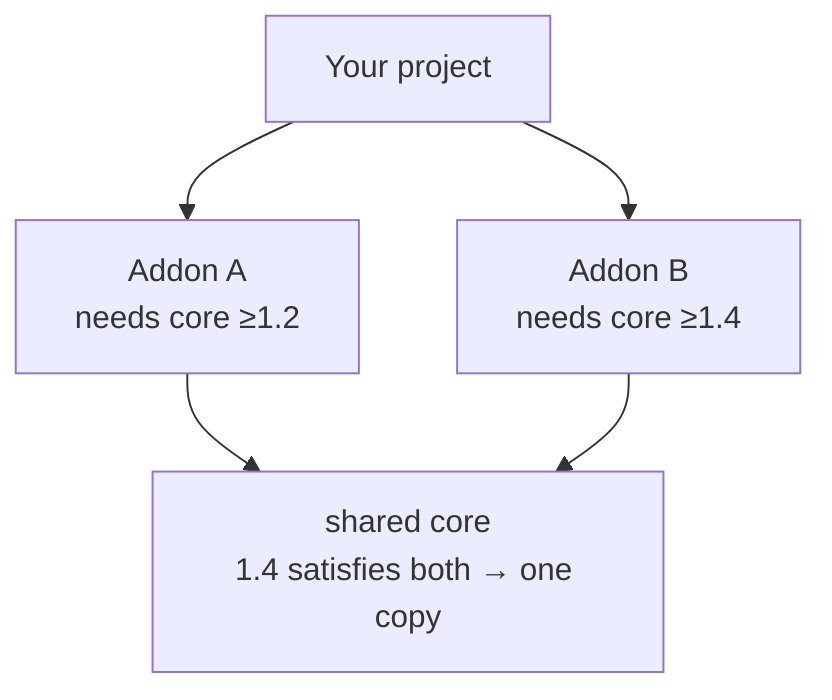
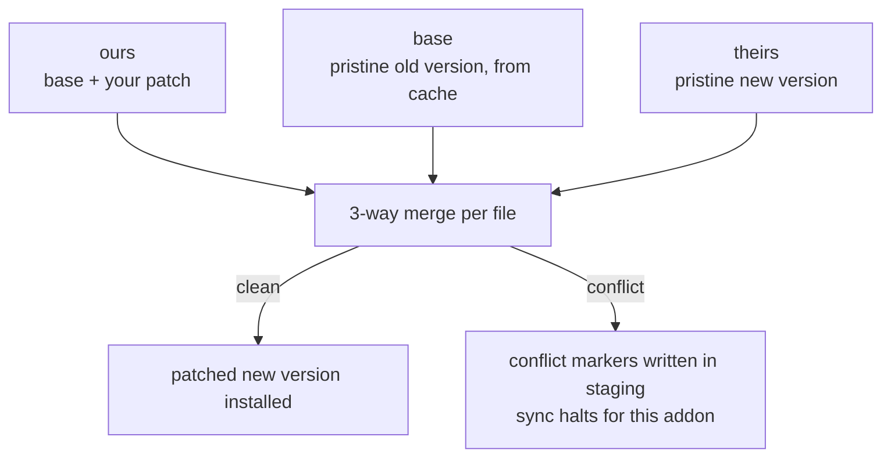
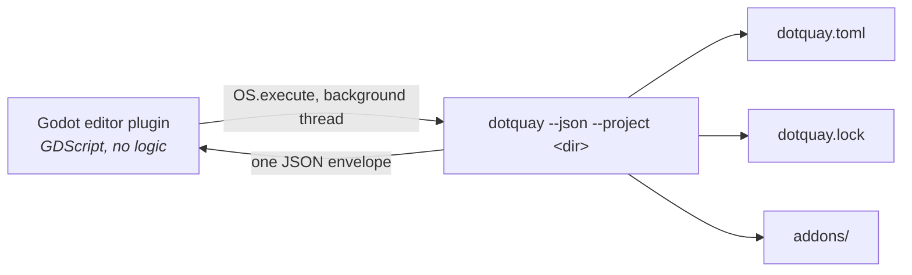

# Dotquay — v1 Specification

A package manager CLI for Godot projects. Manages GDScript addons (installed into `addons/`) from plain git repositories and .NET libraries via NuGet delegation, with reproducible installs, safe updates, and patch support.

Status: draft v1 · Author: Kani · Date: 2026-08-21

---

## 1. Problem statement

Godot has no real package manager. Addons live in git repos under an `addons/` subfolder, which makes them unusable as submodules; updating means manually copying folders and hoping the new version didn't delete files; there is no record of which version a project actually uses, so two teammates cloning the same project can end up with different addons. C# projects additionally split their dependencies across NuGet with no unified view.

The cost: broken updates, unreproducible projects, and manual bookkeeping for every addon — multiplied across every project and teammate.

## 2. Goals

1. **Reproducible installs**: a fresh clone plus `dotquay install` produces a byte-identical `addons/` folder and identical NuGet references, every time, on every machine.
2. **Safe updates**: updating an addon can never leave stale files behind or silently destroy local modifications.
3. **One manifest for both worlds**: GDScript addons and .NET libraries declared in a single `dotquay.toml`.
4. **Works with the ecosystem as it is**: any addon in a git repo is installable — no registry, no author cooperation, no tags required.
5. **Local patches survive updates**: hand-modifications to addons are captured as patch files and re-applied on update with git-grade conflict detection.

## 3. Non-goals

- **Central package registry** — huge separate project; git URLs + NuGet metadata are sufficient sources for v1.
- **Dependency resolution across the unmanaged ecosystem** — third-party addons declare no dependencies, so there is nothing to resolve. Graph resolution exists only for dotquay-aware addons (see §8).
- **Godot 3/4 auto-detection** — branch conventions vary per repo; the user picks the branch explicitly.
- ~~**Editor plugin / GUI** — CLI only.~~ **Reversed in v0.5** (§17, §18): the GUI ships, but strictly as a *wrapper*. The plugin is GDScript-only, holds no resolution logic of its own, and reaches dotquay exclusively through `--json`. Every button is one CLI invocation; the CLI remains the only thing that writes `dotquay.toml`, `dotquay.lock`, or `addons/`.
- **Godot Asset Library integration** — the asset library lags behind git repos; git is the source of truth. Revisit as a P2 source type.

## 4. User stories

Ordered by priority.

1. As a **Godot developer**, I want to add an addon by git URL and have it appear in `addons/` at the right version, so that I never manually copy folders again.
2. As a **teammate**, I want to clone a project and run one command to get the exact same addons and NuGet packages, so that "works on my machine" disappears.
3. As a **Godot developer**, I want to update one addon (or all) and have old files removed cleanly, so that deleted files in the new version don't haunt my project.
4. As a **Godot developer**, I want to pin addons that never tag releases to an exact commit, so that untagged repos are first-class citizens.
5. As a **Godot developer**, I want to track a `godot4` branch of an addon while my lockfile keeps teammates on the exact commit I tested, so that moving targets stay reproducible.
6. As a **C# Godot developer**, I want NuGet libraries in the same manifest as my addons, so that one tool restores everything.
7. As a **Godot developer**, I want my hand-edits to an addon captured as a patch and re-applied after updates, with conflicts detected like git does, so that patching upstream code is safe.
8. As an **addon author**, I want my addon to declare its own addon and NuGet dependencies, so that installing it pulls in everything it needs.
9. As a **Godot developer**, I want to see which addons are outdated without cloning anything, so that checking for updates is fast.

## 5. How it works — the pipeline

Every operation is a pass through four stages. The manifest says *what you want*; the lockfile records *what you actually got*; the sync engine makes disk match the lockfile — nothing else ever writes to `addons/`.


Key consequence: commands split along the stage boundary.

- `install` reads only the **lockfile** — never picks versions. Reproducible.
- `update` re-runs the **resolver** against the manifest, writes a new lockfile, then installs.

## 6. CLI commands

| Command | Stage | Behavior |
|---|---|---|
| `dotquay init` | — | Scaffold `dotquay.toml` in the project root |
| `dotquay init --package` | — | Scaffold a package manifest (with `[package]` header) inside an addon folder |
| `dotquay add <git-url>[#ref] \| <nuget-id>` | resolve | Add dependency to manifest, resolve, lock, install. With no source named, picks the newest release tag; no tags found → pin default-branch tip as `rev` and print a hint. Options: `--version`/`--branch`/`--rev` to name the source outright, `--path` for the subtree (§7.1, OQ-2), `--install-as` for the install folder. `#ref` shorthand asks the remote whether the ref is a branch, tag, or commit (v0.6). `--preview` reports what the add would do and writes nothing; `--adopt-source <url>` pre-approves an addon-declared feed (§6.3, v0.9). `--source <name>` pins a NuGet package to one declared feed; `--keep-generator-private`/`--share-generator` answer the source-generator question without a prompt (v0.14). For a NuGet ID the project already has, `--version` pins a package an addon brought in, or changes the declared version of one the project owns; the entry's feed pin and asset metadata are kept (v0.19, DESIGN-v0.19 §7a.1) |
| `dotquay remove <name>` | sync | Remove from manifest, lockfile, and disk. A NuGet package only the lockfile still mentions is removable too (v0.19). A project entry for a package a reachable addon also declares loses only the declaration, and the lock entry and `PackageReference` stay for the addon (DESIGN-v0.19 §7a.2) |
| `dotquay install` | sync | Make disk match lockfile exactly. Errors if lockfile missing entries from manifest |
| `dotquay update [name]` | resolve | Re-resolve one or all dependencies, rewrite lockfile, install |
| `dotquay list` | — | Show installed dependencies with versions (pseudo-versions for untagged: `0.0.0-20260821-9f2c1ab`) |
| `dotquay outdated` | — | `git ls-remote` per repo + NuGet metadata check; compares against lockfile without cloning |
| `dotquay status` | — | Diff disk against lockfile hashes: `clean` / `patched as expected` / `modified` |
| `dotquay patch <name>` | — | Diff installed addon against pristine cache copy, write `<patches_dir>/<name>.patch` (§10.1). `--resolve` finishes a conflicted update; `--abandon` drops the patch (v0.6) |
| `dotquay doctor` | — | Sanity checks: git on PATH, dangling lockfile entries, `plugin.cfg` version drift, orphaned folders in `addons/`, (v0.5) installed addons shipping an unreadable package manifest, and (v0.9) project code loading an addon resource by a bare `uid://` (§7.3.1) plus addons installed under a wrongly-cased folder (§7.1.1), and (v0.13) an addon installed somewhere other than where the manifest declaring it asks for (§7.1.2), and (v0.18) a package the lockfile binds to a private NuGet feed that `NuGet.Config` does not bind it to |
| `dotquay graph [--resolve]` | — | Print the dependency graph (§8): who requires what, and where it conflicts. Reads the lockfile by default (offline, instant); `--resolve` re-walks live git refs, the only mode that can report unresolved conflicts (v0.5) |
| `dotquay override <name> --version\|--branch\|--rev <value>` | resolve | Write an `[overrides.<name>]` entry and re-apply the graph. `--clear` removes it; no arguments lists them. The escape hatch every conflict message already points at, without hand-editing TOML (v0.5) |
| `dotquay link <name> <path>` | sync | Point an addon at a local folder for development (§7.4). `--remove` unlinks; no arguments lists them (v0.6) |
| `dotquay source add <name> <url>` | — | Declare a NuGet feed (§7.1, §11.1). **Appended** after the feeds already declared, because declaration order is the resolution rule — a new feed must not silently outrank the existing ones. Verifies the service index before writing; `--no-verify` skips (v0.14) |
| `dotquay source list` | — | Show declared feeds in search order, whether a credential resolves for each, and the implicit `nuget.org` (v0.14) |
| `dotquay source remove <name>` | — | Remove a declared feed. Refuses while a manifest pin or lockfile record still names it; `--force` clears those and reports each one (v0.14) |
| `dotquay login [<host\|url>]` | — | Store a username/token for a host in the shared credential file (§11.2). `--token-stdin` for scripts, no-echo prompt otherwise; `--list` shows hosts without tokens; verifies before saving unless `--no-verify` (v0.7). A bare host is verified against the URLs the current project's manifest already uses on it (NuGet feeds first, then git remotes); outside a project the check is skipped and says so (v0.19) |
| `dotquay logout <host>` | — | Remove that host's stored credential. Exact key only — never prefix-matched (v0.7) |
| `dotquay self check` | — | Ask the release channel whether a newer dotquay exists (§19). Exits 3 when one does — not 1, because a newer dotquay is not a failure (v0.17) |
| `dotquay self update` | — | Download, verify and install the newest dotquay, replacing this executable (§19). `--to <version>` pins a version (older allowed, and said out loud); `--dry-run` reports and writes nothing; `--force` reinstalls and skips the build-output guard (v0.17) |
| `dotquay self rollback` | — | Restore the binary the last update replaced, after re-checking that it still starts (v0.17) |
| `dotquay self notify on\|off` | — | Turn the passive "a newer dotquay exists" line on or off. Never affects `self check` or `self update` (v0.17) |

Two options are global to every command (v0.5):

- `--project <dir>` / `-C <dir>` — operate on that directory instead of the current one. Needed because a GUI caller cannot set a working directory (§18).
- `--json` — emit one machine-readable document on stdout and nothing else (§17).

### 6.2 Naming a source on `add` (v0.6)

`add` originally always guessed: newest release tag, or a `rev` pin to the default branch's tip for a
repo with no tags. That is the right default and the wrong only option — "give me this repo on `main`"
is the most common thing it can't express, and it previously meant hand-editing the manifest right
after adding.

Two ways to say it, and they can't be combined:

- **Flags** — `--version "~2.5"`, `--branch main`, `--rev <sha>`. Exactly one, mirroring §7.1's rule
  that an `[addons.*]` entry names exactly one source. `--version` works for git *and* NuGet, matching
  the manifest, where `version` means the same thing on both sides.
- **`#ref` shorthand** — `dotquay add <url>#main`. Resolved by asking the remote, not by inspecting the
  string: a branch becomes `branch`, a tag becomes an **exact** `version`, and a 40-character hex (or
  a 7+ character one that matches nothing) becomes `rev`. A branch wins over a same-named tag.

Deliberately not pattern-matched, because guessing is wrong often enough to matter — `1.0` is a real
branch naming convention and `release` is a plausible tag, and picking wrong silently gives a moving
branch where a fixed tag was meant, or the reverse. An unknown ref lists the branches and recent tags
that do exist rather than just refusing.

A named tag becomes an exact pin, not a widened range: typing one tag is a request for that tag, and
broadening `v1.0.0` to `~1.0` would install something nobody wrote down.

### 6.3 Previewing an `add` (v0.9)

Two of an `add`'s consequences are invisible from the URL a user typed: the addons it pulls in
transitively, and the NuGet feeds those addons declare (§11.3). At a terminal the second is a prompt.
The editor plugin cannot answer a prompt — it drives dotquay through captured stdout — so before v0.9
its only options were to refuse every feed or to adopt blindly.

`dotquay add <git-url> --preview` closes that gap. It runs the real graph walk and reports:

| Field | What it answers |
|---|---|
| `addons[]` | Every addon the graph resolves to, with `is_new`, `previous_resolved`, and `required_by` — so "you asked for this" is distinguishable from "this came along", and "arrives" from "moves" |
| `dotnet[]` | The NuGet packages those addons declare, attributed to the addon that declared each |
| `sources_to_adopt[]` | Feeds that would be taken on without asking: host in `trusted_hosts`, or named in `--adopt-source` |
| `sources_needing_approval[]` | Feeds that need an explicit yes, with the ID patterns they would own and the packages that depend on them |

It **writes nothing** — no manifest, no lockfile, nothing under `addons/`. That property is asserted
directly rather than inferred, because a preview that mutates is worse than no preview: the user's
"cancel" would already be too late.

`--adopt-source <url>` (repeatable) carries the answer back into the real add. Deliberately a
whitelist of exact URLs rather than a "yes to everything" flag: between the preview and the
confirmation the upstream addon may have changed what it declares, and approving a URL the user never
saw is the failure mode §11.3's seam exists to prevent. Approval is **per run** — it never widens
`trusted_hosts`, so agreeing to one addon's feed does not pre-approve the next addon from the same
host.

Two contract details a consumer depends on:

- The envelope's `command` is **`add-preview`**, not `add`. A preview emits `AddPreviewJson` where
  `add` emits `OperationJson`, and reporting both as "add" would hand the wrong parser a payload it
  would half-read rather than reject.
- Exit code **2** means "resolved fine, and a feed needs approval". Zero would tell a script the add
  is ready to run unattended when it isn't; one would say the preview failed, which it didn't — it
  succeeded at discovering a question.

`--preview` is git-only. A NuGet add resolves one version from feeds the project already declares:
there is no graph and no adoption to preview, so it says that instead of emitting an empty payload the
caller has to recognise as meaningless.

### 6.1 `outdated` / `status` / `doctor` implementation notes (v0.2)

`outdated` checks each locked entry against its live upstream without touching disk: `version`- and
`branch`-sourced addons via `git ls-remote` (reusing the same tag-matching logic as the resolver,
just read-only), dotnet packages via a `NuGetVersionSelector.CheckForNewerWithinAsync` metadata
query (`NuGetVersion` comparison, not string equality, so normalization differences like `"13.0.3"`
vs. `"13.0.3.0"` don't false-positive). Since v0.21 the NuGet check selects inside the manifest's own
range (§7.1.5), the version `update` would pick, so a package pinned to `3.0.0` is not reported outdated
while `3.1.1` exists; with no range it is the newest stable release as before. A range that does not
parse is an error naming the package. `rev`-sourced addons are skipped entirely — a hard pin has
nothing upstream to compare against. An entry locked but no longer declared in the manifest is also
skipped (that drift is `doctor`'s job, not `outdated`'s).

`status` is purely local: it reuses `DirtyChecker`'s exact content-hash comparison (the same check
install/update already trust before touching an installed addon, requirement P0-6) rather than a
second implementation. In addition to the three states named above, a fourth `missing` state covers
an addon whose folder isn't on disk at all — not a named SPEC state, but common (before the first
`install`, or after a manual delete) and worth reporting distinctly rather than as "clean" or
crashing.

`doctor`'s `plugin.cfg` version-drift check reuses Tomlyn (`Doctor/PluginCfgReader.cs`): Godot's
ConfigFile format for `plugin.cfg` — `[section]` headers plus `key="value"` pairs — is valid TOML for
every real addon surveyed, confirmed against Gut's real `plugin.cfg` during verification, so this
avoids writing a second bespoke parser. Comparison uses `AddonVersion` (the same lenient tag parser
the resolver uses) rather than string equality, and skips addons pinned to a pseudo-version
(`0.0.0-...`, i.e. untagged/rev-pinned) since those have no real upstream release version to compare
against in the first place. The "git on PATH" check is a new `IGitClient.IsAvailableAsync` method
(`git --version`, no network); the "orphaned folders in `addons/`" check needed a new
`IFileSystem.EnumerateDirectories` — the abstraction only had `EnumerateFiles` before.

### 6.2 Patch workflow implementation notes (v0.3)

Three new local git plumbing primitives, behind `IPatchTool`/`ProcessPatchTool`
(`Dotquay.Core.Patch`), kept separate from `IGitClient` since none of them touch the network: `git
diff --no-index` (capture), `git apply` (reconstruct "ours" from a patch), `git merge-file`
(per-file 3-way merge). `git diff --no-index dir1 dir2` embeds the literal argument text into its
patch headers, so `DiffDirectoriesAsync` always aliases both sides to fixed one-segment names
(`base`/`ours`, via a real directory copy — not a symlink/junction, which would be Windows-only)
before diffing, making the strip count at apply time (`git apply -p2`) a constant regardless of
where capture and re-application each happen to run. `ApplyPatchAsync` runs with its working
directory set to the target, not `--directory=<target>` — confirmed against real git on Windows that
an absolute, backslash-separated `--directory` value produces `error: invalid path`, while
CWD-based resolution (relying on `-p2` already leaving bare relative paths) is both simpler and
portable.

`dotquay patch <name>` (`DependencyWorkflow.PatchAsync`) diffs `addons/<name>` against a fresh
extraction of the pristine cache copy at the locked SHA, writes `patches/<name>.patch`, and records
`patch_hash` (a fingerprint of the patch file's own content) and `patch_base_sha` (the SHA the patch
applies against — tracked separately from `resolved` because it must stay fixed across a clean
`update`, only moving when the user re-runs `patch`). An empty diff clears both fields instead of
writing an empty file. Capturing also recomputes `content_hash` from the current (patched) tree —
without this, the dirty check (P0-6) would refuse every later `install`/`update` of a patched addon,
since `content_hash` would still point at the pre-patch tree forever; caught during real-repo
verification, not by the unit tests, which didn't have real dirty-check plumbing in the loop.

Re-application (`AddonInstaller.InstallAsync`, given the previous `LockedAddon`) reconstructs "ours"
as *the old pristine base plus the patch* (never the currently-installed tree — that keeps the merge
input equal to exactly what `dotquay patch` captured) and 3-way merges it against the freshly
extracted new version via `PatchMerger`, per file, across the union of (base, ours, theirs): pure
adds on either side are kept as-is; adds on both sides compare content (identical → clean, different
→ add/add conflict against a synthesized empty base, the same trick git itself uses); deletes are
clean when the surviving side matches base, otherwise a delete/modify conflict that keeps the
surviving side's content rather than silently discarding it; the standard present-in-all-three case
fast-paths on byte-equality (both sides unchanged, or only one side changed) before falling back to
a real `git merge-file` call — sidestepping git's line-based merge for binary files whenever
possible, and correctly falling through to a flagged conflict when a binary file genuinely differs on
both sides. A clean merge overwrites the install's staging tree in place and the swap proceeds
normally, carrying `patch_hash`/`patch_base_sha` forward into the new lockfile entry. A conflicted
merge aborts *before* the swap: `addons/<name>` is left exactly as it was, the conflict-marked merge
result is left in `.dotquay/staging/<name>` for inspection, and the lockfile is not rewritten.

Verified against a real local git repository (not just fakes) end to end, both directions: a
hand-edit captured as a patch survives an `update` that also pulls in an unrelated new file from
upstream (clean 3-way merge, `status` reports `patched as expected` afterward); and a hand-edit that
collides with an upstream change to the exact same line produces the expected conflict — exit code
1, conflict markers under `.dotquay/staging/demo_addon/`, `addons/demo_addon/` byte-identical to
before the `update` was attempted, lockfile untouched. This surfaced and fixed two real bugs the unit
tests (fakes only) didn't catch: the `--directory` path issue above, and the `content_hash` staleness
issue above.

### 7.1.1 The addon's repository decides its folder's casing (v0.9)

A Godot addon refers to its own files by absolute `res://addons/<folder>/` paths, and those are
case-sensitive strings even where the filesystem is not. So the folder an addon must live in is a
fact its repository states; `addons/<name>` derived from the URL is only a guess at it.

Gut is the worked example. The repository is `bitwes/Gut`, so the guess was `addons/Gut` — but its
subtree is `addons/gut`, and 219 references across its own files say `res://addons/gut/`. On Windows
that installs and appears to work, because the filesystem is case-insensitive. Godot then repairs
every one of those references to the real casing and re-saves the scenes and resources involved, so
the addon reports as hand-modified forever and floods the editor with errors on each open. On a
case-sensitive filesystem the same install simply fails.

`AddonInstaller` therefore resolves the configured subtree against the fetched repository's actual
casing (`SubtreeExtractor.ResolveSubtreePath`) and, when nothing said otherwise, installs under that
real name.

Deliberately narrow: it corrects **capitalisation, never identity**. A segment with no
case-insensitive match is left exactly as configured, so the existing "path does not exist in the
fetched repository" error still fires and dotquay still never infers a layout it wasn't told (§7.1,
OQ-2). An explicit `install_as` always wins. For a project already installed at the wrong case this
reads as a rename, which the existing rename guard handles — so it repairs itself on the next update.

`doctor` reports the condition independently (`addon_folder_case_mismatch`), because a project can
reach it before this correction existed, and because the symptom points nowhere near the cause:
finding it by hand meant diffing an installed addon against a fresh clone of its own locked commit,
while the evidence sat in the addon's own files the whole time.

### 7.1.2 The manifest's `install_as` and the lockfile's folder can disagree (v0.13)

`install` replays the lockfile and deliberately never re-reads the manifest (§5). So adding, changing,
or removing `install_as` changes nothing on disk until an `update` re-resolves — and in between, the
committed manifest asks for one folder while the addon sits in another.

That is not corruption, and it is not something `install` should silently repair: re-reading the
manifest there would cost reproducibility, which is the point of the split. But it is invisible, and
every symptom of it appears somewhere else entirely — a `preload("res://addons/…")` that no longer
resolves, an addon that looks installed twice, an orphan report naming the folder that is in fact the
live one.

`doctor` reports it as `install_folder_drift` (`Doctor/InstallFolderDriftChecker.cs`), comparing two
files already on disk with no network involved, in the same spirit as `package_asset_metadata_drift`.
Three things it deliberately does not do:

- **A case-only difference where no `install_as` was stated is not drift.** That is §7.1.1's folder-case
  correction working: the addon's repository, not the manifest key, is the authority on its folder's
  casing. Reporting it would fire on every addon that correction has ever repaired, and the advice
  would be to undo the fix. Where an `install_as` *is* stated, the casing is stated too, and the
  comparison is ordinal.
- **Precedence mirrors resolution rather than inventing its own**: `[overrides.*]` first (§8), then the
  project's own `[addons.*]`, then what a dependent addon's package manifest asks for. Transitive
  addons are covered because that is where this goes wrong most quietly — a parent that starts
  declaring `install_as` for a shared dependency changes nothing about that dependency's commit.
- **Two parents asking for different folders is silent here.** That is a resolution conflict with its
  own reporting (§8); doctor picking a winner would contradict whatever resolution decides.

### 7.1.3 A `path` can point at a Godot project instead of an addon (v0.19)

`path` names the subtree of the addon's repository that is copied into `addons/<folder>`. When that
repository is restructured — the plugin moved from the root into `addons/<name>/` so the root can be
a playable Godot project — every manifest still saying `path = "."` keeps working perfectly, by every
measure dotquay has: the subtree exists, extracts, hashes, and installs. It just now contains
`project.godot`, a nested `addons/`, and no `plugin.cfg` where Godot looks for one. The single
symptom is the editor reporting the plugin as missing, and `install`, replaying the lockfile, repeats
it faithfully.

The worked example is vrm-addon (2026-09-18). It moved its plugin to `addons/vrm`; vbeami's package
manifest still declared it with `path = "."`; every consumer of vbeami got the whole vrm-addon
repository under `addons/vrm`, with nothing reporting why. Worse, the only thing reported was the
project root's own `[project]` manifest lacking a `[package]` header — advice that, followed, would
have been exactly wrong.

`GodotProjectRootChecker` (`Doctor/`) tells the two apart the way Godot itself does: a subtree with
`project.godot` and no `plugin.cfg` beside it is a project root. An addon that ships a
`project.godot` next to its own `plugin.cfg` is still an addon; a content-only folder with neither
is left alone. It then looks for the real addon under the subtree's `addons/` — the candidate whose
folder matches the addon's name wins, an only candidate wins by default, and anything else is
listed rather than guessed at.

Two reports, both naming the manifest whose `path` is wrong (the project's own `[overrides.*]` or
`[addons.*]`, or the package manifest of the addon that depends on it) and the exact `override`
that pins the fix from the consuming project meanwhile:

- the resolver warns (`SubtreeIsGodotProject`, §8) during `add`/`update`/`graph`, quoting the
  branch or range the declaring spec used, and stays quiet about the project manifest it would
  otherwise have reported as unreadable;
- `doctor` reports `addon_folder_is_godot_project` offline from the installed folder, pinning the
  locked commit with `--rev` because it has no declaring spec to quote, and likewise drops the
  `unreadable_package_manifest` report for that folder.

Reported, never corrected. §7.1.1's folder-case correction is allowed to act because capitalisation
changes nothing about *what* is installed; swapping `path = "."` for `addons/vrm` changes identity
and content, and would have to guess between plugins whenever a project ships more than one.

### 7.1.4 A guessed subtree is offered, never assumed (v0.20)

`add <git-url>` derives the addon's name from the URL's last segment and guesses its subtree as
`addons/<name>`. §7.1.1 repairs that guess's capitalisation and deliberately nothing else, which
leaves the commonest disagreement in the Godot ecosystem uncovered: a PascalCase repository name over
a snake_case addon folder. `SproutyLabs/SproutyDialogs` holds `addons/sprouty_dialogs`, so the case
correction declines — correctly, by its own contract — and the user gets
`Configured path 'addons/SproutyDialogs' does not exist in the fetched repository`, which names the
path that didn't work and nothing about the one that would have.

`add` now probes the fetched repository before anything is written and offers what it finds
(`SubtreeCandidates`, `Sync/`). Two rules, both narrow:

- **The same words in a different convention.** Both names reduced to their letters and digits,
  lowercased: `SproutyDialogs` ≡ `sprouty_dialogs` ≡ `sprouty-dialogs`.
- **The only addon in the repository.** Exactly one directory holding a `plugin.cfg` — searched at
  `addons/*`, then the repository root itself (for which the fix is the `path = "."` OQ-2 already
  requires to be stated), then `*/addons/*` one level down for a repository whose Godot project lives
  in a subfolder.

Deliberately *not* matched: a dropped leading or trailing word (`godot_dialogue_manager` →
`dialogue_manager`), because the same rule matches `core` against `vbeami_core`, which is a different
addon rather than the same one spelled differently; and anything fuzzy, because a suggestion that is
merely near is one whose confirmation prompt cannot be honest about what it found. Two or more
candidates under either rule means no suggestion at all: the message lists them.

Nothing is adopted without an answer. `ISubtreeChoice` is a seam like `ISourceApproval` (§11.3) and
defaults to refusing; the CLI implements it as a `[Y/n]` prompt for an interactive non-`--json` run,
and everything that cannot ask a human — CI, `--json`, the editor plugin — refuses and gets the exact
`--path`/`--install-as` flags in the error instead. An accepted suggestion sets **both** `path` and
`install_as` in `[addons.<name>]`: the addon's own `res://addons/<folder>/` references are
case- and word-sensitive strings (§7.1.1), so accepting the subtree without the folder reproduces the
Gut bug in full. The manifest key is untouched — this corrects layout, never identity.

Two-phase for the plugin, like feed adoption: `add --preview --json` resolves the graph *as if* the
suggestion were accepted and reports it as `subtree` (with `guessed_path`, `path`, `folder`, a fixed
`reason` of `name_shape` or `only_addon`, and an `explanation` sentence) plus the mirror boolean
`needs_subtree_confirmation`, and the preview exits 2 as it does for a feed needing approval. There
is no pre-approved seam: confirming means passing `--path`/`--install-as`, which is what the user
agreed to, and an explicitly stated `path` is never probed.

`install` is untouched — it replays a lockfile, which already records the answer. A transitive
addon's `path` is not guessed either: it comes from someone else's package manifest, so
`SubtreeExtractor`'s "does not exist in the fetched repository" error gains the candidate list and an
`override --path` line, and that is the whole change on that path (same split as §7.1.3).

### 7.1.5 One version-constraint language (v0.21)

Every `version` field — `[addons.*]` and `[dotnet.*]`, project and package manifests — uses the same
grammar: node-semver's, the majority language across npm, Yarn, Helm, Cargo, Composer and Poetry
(survey and rationale: `docs/DESIGN-v0.21-VERSION-CONSTRAINTS.md`).

| Written | Means |
| --- | --- |
| `1.2.3` / `=1.2.3` | exactly 1.2.3 |
| `1.2` / `1.2.x` / `1.2.*` | `>=1.2.0 <1.3.0` |
| `~1.2.3` / `~1.2` / `~1` | `<1.3.0` / `<1.3.0` / `<2.0.0` |
| `^1.2.3` / `^0.2.3` / `^0.0.3` | `<2.0.0` / `<0.3.0` / `<0.0.4` |
| `1.2 - 1.4.5`, `>=1.2 <2`, `>=1.2, <2` | ranges; a comma is a synonym for a space |
| `^1.0 \|\| ^2.0` | either |
| `*`, empty | any stable version |

- A fourth component (Phantom Camera's `v0.11.0.3`, NuGet's `Revision`) is compared like the others;
  `~` and `^` never bump it.
- A prerelease is only selected when a comparator of the same range names a prerelease of the same
  version: `^5.1.0-rc1` accepts `5.1.0-rc5` and `5.1.0`, `^5.0` never selects `5.1.0-rc1`.
  Prereleases order by SemVer 2.0 (`rc.2 < rc.10`).
- `update` selects the highest version satisfying every range on a name. For a NuGet package the
  project's own entry wins; otherwise every addon that declares it must be satisfied, and a package
  no version satisfies is a hard error naming each addon and its range.
- `add <git-url>` writes `~I.J`; `add <package-id>` writes `^<resolved>`; `--version` takes any
  range and is written as typed.
- NuGet's own syntax (a bare version as a minimum, `[1.0,2.0)` intervals) is not accepted. dotquay
  resolves the range itself and writes only the exact result into the `.csproj`.
- A restore NuGet refuses leaves the `.csproj` and `NuGet.Config` as they were before the sync.

One change in meaning from earlier versions: a bare *partial* version (`"2.44"`) used to be exact
and is now the x-range `2.44.x`. `add` never wrote one.

### 7.3.1 The editor writes into the folders dotquay manages (v0.9)

Godot generates files *inside* `addons/<name>/`, which puts it in direct conflict with P0-6's "the
installed tree must match what we locked". Opening a project writes a `<script>.gd.uid` beside every
script (4.4+) and rewrites an `<asset>.import` beside every imported asset. A freshly installed addon
therefore read as hand-modified the first time the editor saw it, before anyone touched anything.

That is not cosmetic. `install` and `update` refuse to overwrite a modified addon, so the fix people
find is `--force` — and a guard that fires on every project teaches everyone to bypass it, at which
point it protects nothing.

`content_hash` therefore excludes editor-generated paths: `*.uid`, `*.import`, anything under
`.godot/` or `.import/`, and any file whose *name* starts with `~` (`GodotArtifacts`). The last is
the editor's hot-reload copy of a GDExtension library: loading `GDMP.windows.dll` makes it write
`~GDMP.windows.dll` beside it and load that, so an untouched addon grows a copy of its own native
library. Unlike a `.uid`, that copy carries no identity, so the swap does **not** carry it over —
Godot recreates it on the next load. A fixed list, not configuration — these are facts about Godot,
and making them a setting means every user must discover and get them right before install works.

Three consequences, each load-bearing:

- **The swap carries over generated artifacts the incoming version doesn't ship.** A wholesale replace
  would delete them, Godot would generate *new* UIDs, and every `uid://` reference into the addon
  would point at something gone. An artifact the addon **ships** wins instead — it's versioned
  content, and the author's UID is what the addon's own scenes reference.
- **A hash that reconciles with nothing, over a pristine tree, is not dirty.** A lockfile hash
  describes the tree at install time. For an addon that ships its own `.uid` files *and* whose
  `.import` files the editor has since rewritten, neither the current nor a legacy all-files hash can
  match — on content byte-identical to upstream. Comparing numbers cannot resolve that; comparing
  trees can, so the swap acquits a destination identical to what would replace it and the fresh hash
  re-baselines the lockfile. This cannot mask a hand-edit: it excuses only a tree with nothing to
  lose. Existing projects self-heal on their next `install`.
- **Only one reference shape genuinely breaks**, and `doctor` reports it rather than fixing it.
  Scenes and resources record a `path` beside every `uid`, so a stale UID falls back to the path and
  is repaired on the next save. A bare `uid://…` handed to `load()` has no fallback —
  `fragile_uid_reference`. Rewriting those means dotquay editing the project's own scripts, which is
  a boundary it otherwise never crosses (§18); the risk of a non-atomic, project-wide rewrite is not
  worth a failure Godot mostly repairs itself.

## 7. File formats

### 7.1 Project manifest — `dotquay.toml`

```toml
# [project] is optional and holds patches_dir plus the legacy single nuget_source. A `godot` key
# existed through v0.5; nothing ever read it and the scaffold hardcoded "4.3" into every project
# regardless, so it was removed (v0.6). The reader still ignores it if present.

# NuGet feeds, in search order (v0.7). A legacy [project] nuget_source is read as a source named
# "default". Credentials never appear here — see §11.2.
[nuget.sources.core]
url = "https://gitlab.example.com/api/v4/projects/123/packages/nuget/index.json"

[nuget.sources.tools]
url = "https://gitlab.example.com/api/v4/projects/456/packages/nuget/index.json"

[addons.dialogue_manager]
git = "https://github.com/nathanhoad/godot_dialogue_manager"
version = "~2.44"                  # matched against git tags; grammar in §7.1.5
path = "addons/dialogue_manager"   # subtree to extract; default: addons/<name>

[addons.mtoon-shader]
git = "https://gitlab.example.com/mtoon-shader"
rev = "dd4dd78"
path = "."                         # the repo root IS the addon
install_as = "Godot-MToon-Shader"  # folder under addons/; default: the addon's name

[addons.some_addon]
git = "https://github.com/foo/some_addon"
branch = "godot4"                  # track branch tip; lockfile pins the SHA

[addons.other_addon]
git = "https://github.com/bar/other_addon"
rev = "9f2c1ab"                    # hard pin for untagged repos

[dotnet.Newtonsoft.Json]
version = "13.0.*"                 # same language as addons (§7.1.5); resolved by dotquay

[dotnet.Kani.Core]
version = "1.2.*"
source = "core"                    # optional pin (v0.7); unpinned searches sources in order

[overrides.shared_core]            # project always wins conflicts (§8)
git = "https://github.com/kani/kani_core"
rev = "abc123"
```

Rules: each `[addons.*]` entry names exactly one of `version`, `branch`, or `rev`. `version` requires tags to exist. Whatever the source spec, the lockfile always stores a commit SHA. For repos where the repository root *is* the addon (no `addons/` subfolder), the user must state `path = "."` explicitly — dotquay never guesses the layout (decided, was OQ-2).

**`path` vs `install_as` (v0.5).** They are opposite ends of the same move and are easy to confuse:
`path` is where the addon lives in *its* repo; `install_as` is the folder it lands in under *your*
`addons/`. Neither affects the addon's identity — the manifest key is still the name unification,
dependency edges, and `remove` all key on, so an addon installed under an alias is one addon, not two.

`install_as` exists because a Godot addon's folder name is frequently part of its public contract
rather than a preference. Addons routinely `preload("res://addons/<Name>/...")`, and Godot resolves
`preload` at *parse* time — install such an addon anywhere else and its dependents don't degrade,
they fail to compile, with the error pointing at the innocent dependent rather than at the folder
that moved. The canonical folder often matches neither the repo name nor the manifest key (the
motivating case: a repo named `mtoon-shader` that everything preloads as `Godot-MToon-Shader`).

Consequences, each load-bearing:

- The value must be a **plain folder name** — no slashes, no `..`, no drive letters. Rejected at parse
  time, because the sync engine deletes and replaces that folder wholesale (§9 step 5) and manifests
  are read from third-party repositories nobody in the chain necessarily audited.
- The lockfile records it (`folder`, omitted when it equals the name), so `install` replays the same
  destination and a transitive addon — which appears in no manifest the project owns — is still
  findable.
- Changing it **moves** the addon: the old folder is deleted, or Godot keeps loading the stale copy
  and the rename only appears to have worked. The dirty check applies to the folder being deleted, not
  just the one being written, or renaming would be the one way to destroy hand-edits without asking.
- Two requirers wanting different folders is a **hard error** (§8), not a first-wins guess. Unlike
  `path`, a wrong choice here breaks a dependent addon at parse time.

### 7.2 Package manifest — `dotquay.toml` inside an addon

Same schema plus a `[package]` header. Ships in the addon's folder next to `plugin.cfg`, so the metadata travels with the package. An addon repo is itself a valid dotquay project — addons are developed *using* dotquay.

```toml
[package]
name = "kani_dialogue_tools"      # required; `version` is optional and read by nothing (v0.6) —
                                  # plugin.cfg and the git tag already carry it

[addons.kani_core]
git = "https://github.com/kani/kani_core"
version = "~1.4"

[dotnet.Newtonsoft.Json]
version = "13.0.*"
```

Third-party addons without this file are leaf nodes. The graph feature costs them nothing.

**The manifest must be inside the installed subtree.** Discovery extracts whatever a consumer's
`path` points at (§9 step 2) and looks for `dotquay.toml` *there* — never at the repo root. This
isn't a convention, it's forced: the subtree is the only thing that is ever copied into a consumer's
`addons/`, so a manifest outside it does not exist from the consumer's point of view and could never
declare anything for them.

This bites a specific, common layout. An addon repo that is itself a Godot project keeps its own
`dotquay.toml` next to `project.godot` — e.g. `godot/dotquay.toml`, with the addon at
`godot/addons/<name>/`. Those are two different manifests answering two different questions, and both
are needed:

| File | Kind | Answers |
|---|---|---|
| `godot/dotquay.toml` | `[project]` | "what do I need to develop this addon" |
| `godot/addons/<name>/dotquay.toml` | `[package]` | "what must anyone *using* this addon also get" |

Before v0.5 an addon in this shape resolved and installed perfectly while every dependency it
declared was silently dropped, with nothing reported anywhere. Two warnings now cover it (§17), and
`dotquay doctor` gained an offline check for the second one:

- the subtree has no `dotquay.toml` but the repo has one elsewhere — almost always this mistake;
- the subtree has one that isn't a valid package manifest, usually a missing `[package]` header.

Both keep the leaf behaviour exactly as it was. They change the silence, not the resolution.

A third shape looks like the second and is not: the subtree *is* the Godot project, because the
addon moved into `addons/<name>/` after the consumer's `path` was written. Its `[project]` manifest
is then read as a package manifest and reported as unreadable, when the file is not the problem at
all — §7.1.3 covers that case and takes precedence over this report.

### 7.3 Lockfile — `dotquay.lock`

Machine-written TOML, committed to the repo. One entry per resolved dependency:

```toml
[[addon]]
name = "dialogue_manager"
git = "https://github.com/nathanhoad/godot_dialogue_manager"
resolved = "e4f7a21c..."           # always a full commit SHA
version = "2.46.1"                 # display only; pseudo-version if untagged (0.0.0-<commit date, UTC>-<short sha>)
path = "addons/dialogue_manager"   # source subtree in the addon's repo
folder = "Godot-MToon-Shader"      # install destination; omitted when it equals name (v0.5)
content_hash = "sha256:..."        # hash of installed tree, for dirty detection (§7.3.1)
patch_hash = "sha256:..."          # present only if patched
patch_base_sha = "e4f7a21c..."     # SHA the patch was captured against; present only if patched
dependencies = ["kani_core"]       # graph edges — install never re-reads remote manifests

[[dotnet]]
name = "Newtonsoft.Json"
resolved = "13.0.3"

[[dotnet]]
name = "Kani.Core"
resolved = "1.2.7"
source = "core"                    # feed it resolved from; omitted for nuget.org (v0.7)
```

`source` (v0.7) is what keeps multi-feed resolution reproducible: a package that resolved from a
private feed on one machine cannot quietly come from a public one on the next `install`. Absent means
nuget.org, so lockfiles written before v0.7 read unchanged.

### 7.4 Local links — `dotquay.local.toml` (v0.6)

Per-machine, **never committed**. Points an addon at a folder on this machine instead of its
upstream repository:

```toml
[link.mtoon-shader]
path = "F:/projects/godot/mtoon-shader"   # the addon folder itself
```

Resolution is commit-based by design (§5), which is right for reproducibility and wrong for the
person *writing* the addon: every edit otherwise means commit → push → `dotquay update` before the
consuming project sees it. A link installs `addons/<folder>` as a directory link into the working
checkout, so an edit is live on Godot's next reload with no dotquay command at all.

- **Managed with `dotquay link <name> <path>`** and removed with `--remove`; bare `dotquay link`
  lists them. The command appends the file to an existing `.gitignore`, because the value is an
  absolute path on one person's disk and committing it breaks every teammate and every CI run.
- **The lockfile is untouched** and keeps naming the upstream commit. A link is a local detour, not a
  change to what the project depends on — anyone without the link is unaffected, and unlinking puts
  this machine straight back on what the lockfile always said. `content_hash` is deliberately not
  recomputed: hashing a live working copy would record in-progress edits as the expected content of
  a release.
- **`update` holds the whole entry, not just the hash.** `resolved`, `version` and `content_hash`
  describe one commit between them, and a link installs none of it — so `update` re-resolves a linked
  addon, sees the newer commit, and leaves all three exactly where they were. Advancing the sha alone,
  which it used to do, produced a committed lockfile naming two commits at once: a fresh clone
  installed the newer commit's tree, compared it against the older commit's hash, and reported an
  addon nobody had touched as `modified` — on a machine with no link, where that entry is the whole
  of the truth. Being held back is reported as a warning rather than passed off as "unchanged", since
  the two are indistinguishable on screen and mean opposite things. Moving the project onto the newer
  commit is `dotquay link <name> --remove`, then `update`, then link again.
- **A linked addon reports `linked`**, its own status, not `clean` or `modified`. Its contents are a
  working copy and will never match the lockfile; without this every linked addon would sit
  permanently in a state that reads like a problem, and the dirty check would refuse to touch it.
- **Replacing a real installed addon with a link runs the dirty check** (requirement P0-6) — linking
  must not be a way to discard hand-edits without asking.
- **Deleting a linked folder removes the link, never its target.** `addons/<folder>` is deleted during
  orphan pruning, `remove`, and the `install_as` rename; when it's a link, that folder is somebody's
  source checkout. Recursing through one is the only way dotquay could destroy work git cannot bring
  back, so `IFileSystem.DeleteDirectory` is required not to follow links.
- **A linked addon renames like any other** (v0.13). Changing `install_as` moves the link and retires
  the old folder, on the same path an installed copy takes. Skipping that left the previous
  `addons/<folder>` in place as a second live link into the same checkout, so Godot loaded the addon
  twice under two names and the folder the rename was meant to vacate kept satisfying every `res://`
  path it was meant to redirect. The rename's dirty check is skipped when the folder it is retiring is
  itself a link: a link holds no content of its own, and hashing it would read the developer's
  in-progress edits as hand-edits to the addon and refuse the rename over them.

Implemented as a junction on Windows and a symlink elsewhere. Windows only permits unprivileged
symlink creation with Developer Mode enabled, which is off by default; junctions have no such
requirement and Godot follows both identically.

**Local .NET links, and the overlay** (v0.11; `docs/DESIGN-v0.11-LOCAL-DOTNET-LINK.md`). A `[dotnet]`
package can be linked the same way, to a local `.csproj` (`dotquay link <package> <path>`;
`--analyzer` for a Roslyn analyzer or source generator). The link lives in `dotquay.local.toml`, and
dotquay turns it into `dotquay.local.targets`, a generated, per-machine, gitignored MSBuild file next
to the project that swaps the `PackageReference` for a `ProjectReference`. The committed `.csproj`
carries only one inert line importing it (`Condition="Exists(...)"`), so a link can never be
committed. The overlay is rewritten whole by `install`, `add`, `update` and `override` (and so by
`link` and `link --remove`, which end in an install), and deleted when the last link goes; an overlay
from an older dotquay is therefore upgraded by the next such command, with no relink.

For an `--analyzer` link the overlay also carries the target `DotquayStageLinkedAnalyzers`. Roslyn
hosts (an IDE, a Roslyn MCP server) load an analyzer in place and hold a file lock on it, which would
stop the linked generator from ever being rebuilt. The target compiles against a copy of every
locally built analyzer, in `obj/<config>/<tfm>/linked-analyzers/<name>-<sha256>/`, and sweeps the
copies of earlier builds. Set `DisableDotquayAnalyzerStaging=true` to opt out. Unlinking deletes the
overlay and with it the sweep, so the copies from the last builds stay in `obj/` until it is cleaned;
at most one copy per generator build accumulates while the link lives, and a copy a host still holds
is removed by a later build once that host has exited. Why the copy keeps the file name and carries
the hash in its directory is in the design document.


## 8. Resolution

The resolver walks the dependency graph breadth-first, reading each dotquay-aware addon's package manifest, and collects all constraints per addon name. Godot's flat `addons/` folder allows exactly one copy of each addon, so the policy is **unification, not side-by-side**:

- Pick the highest version satisfying all constraints on a name — git tags and NuGet packages alike (§7.1.5).
- Constraints that cannot be unified (e.g. two different `rev` pins) are a hard error.
- Two requirers wanting the same addon in different `install_as` folders is a hard error too (v0.5),
  reported before any version disagreement — it's the one a user can't discover from a version error.
- `[overrides]` in the *project* manifest wins unconditionally — the escape hatch.



This is deliberately *not* a full constraint solver. It works because only dotquay-aware addons (initially: Kani's own, properly tagged) declare dependencies. The lockfile stores graph edges so `install` replays the graph without network access to manifests.

## 9. Sync engine

`addons/<name>/` is a **derived artifact owned by dotquay** — never merged, always replaced.

1. Fetch into the global cache: `~/.dotquay/cache/<repo-hash>/<short-sha>/` (content-addressed; shared across projects). Cache paths use a short hash of the repo URL plus an abbreviated SHA to keep paths short on Windows (decided, was OQ-5). Shallow fetch is the baseline, not an optimization — full clone only as a fallback when the server refuses shallow fetch of a specific SHA (decided, was OQ-4).
2. Extract the manifest's `path` subtree into a **staging folder** — this solves the "addon is not at repo root" problem without submodules.
3. Apply patch if present (§10).
4. Dirty check: hash the currently installed folder against the lockfile's `content_hash` (or `content_hash` + `patch_hash`). Mismatch → refuse with a message pointing at `dotquay patch` or `--force`.
5. Atomic swap: delete old folder, rename staging in. Deleted upstream files disappear for free because nothing is ever merged.

The project folder is never left half-updated: all failures happen in staging.

## 10. Patches

Local edits to addons are first-class. Because the lockfile records the exact base SHA and the cache holds the pristine copy, dotquay can run a true git-style **3-way merge** — strictly better than patch-tools that can only fail.



Workflow:

1. Edit the installed addon directly.
2. `dotquay patch <name>` diffs against the pristine cache copy → writes `patches/<name>.patch` (committed, so teammates get it). Lockfile records `patch_hash`.
3. On `install`/`update`, the patch is re-applied in staging via 3-way merge (`git merge-file` per file). Clean → atomic swap as usual. Conflict → `<<<<<<<`/`>>>>>>>` markers in staging, sync halts for that addon with instructions: resolve in staging, run `dotquay patch <name>` to re-capture against the new base.

### 10.1 Where patches live, and finishing a conflict (v0.6)

Patches default to `.dotquay/patches/` and are configurable via `[project] patches_dir`. Because
`.dotquay/` also holds cache and staging, dotquay writes a `.dotquay/.gitignore` when it first
captures a patch:

```gitignore
*
!.gitignore
!patches/
!patches/**
```

The folder carries its own rules rather than relying on every project's root `.gitignore` drawing the
distinction — patches are source and only work if teammates get them, while cache and staging must
never be committed. A project that already has a `patches/` folder keeps using it: changing the
default without that fallback would make dotquay stop looking where existing patches are, and those
projects would silently install unpatched code while `status` reported everything fine.

**Re-applying a patch is automatic on every install and update.** The two commands that exist are for
the moments that aren't automatic: capturing the edit, and deciding what to do when upstream changes
the same lines.

- `dotquay patch <name> --resolve` — install the files you fixed in staging and recapture in one step.
- `dotquay patch <name> --abandon` — drop the patch and take upstream as-is.

A conflicted update aborts before writing the lockfile, which still names the *old* commit. The
conflict therefore also writes `.dotquay/staging/<name>.conflict` recording the commit the staged tree
came from, and `--resolve` uses it to advance the lockfile before recapturing. Without that note the
recapture diffs against the old base and produces a patch that conflicts against upstream on every
future update — resolve appears to work once and then wedges the addon permanently.

## 11. .NET / NuGet handling

Dotquay does **not** reimplement NuGet. It:

- writes `PackageReference` entries into the project's `.csproj`,
- unions in `[dotnet]` dependencies declared by installed addons,
- shells out to `dotnet restore`,
- reads NuGet metadata for `add`/`outdated`/`list` (`NuGetV3Client`) by discovering the source's V3
  service index (`index.json`'s `resources[]`, matching on `@type == "PackageBaseAddress/3.0.0"`)
  and querying that resource directly over HTTP with source-generated `System.Text.Json` — not the
  official `NuGet.Protocol` library, as originally planned here. `NuGet.Protocol` crashes under
  NativeAOT even for this simple read-only query: it always fetches repository signature metadata
  first, and that path deserializes `NuGet.Protocol.RepositoryCertificateInfo` through
  Newtonsoft.Json's reflection-based binder, which the trimmer strips (confirmed via a real AOT
  publish, `docs/SPRINT-01.md`, 2026-08-21). Same shape of finding, same kind of fix, as OQ-1's
  Spectre.Console.Cli swap. Discovering the resource dynamically (rather than hardcoding nuget.org's
  fixed `v3-flatcontainer` path) is what makes the same client work against any V3-compliant source —
  confirmed against nuget.org and against a real private GitLab package registry, which exposes the
  equivalent resource at a completely different path (`.../nuget/download`).

Which version to use is dotquay's decision, made with the same constraint language as for addons
(§7.1.5, v0.21): the `.csproj` receives the exact result and the lockfile records it. Downloading,
caching and the transitive graph below each package stay NuGet's job; a combination NuGet refuses
at restore leaves the project as it was.

### 11.1 Private / authenticated NuGet feeds

A project declares its feeds in `dotquay.toml` as an **ordered, named set** (§7.1):

```toml
[nuget.sources.core]
url = "https://gitlab.example.com/api/v4/projects/123/packages/nuget/index.json"
```

Each `url` is a V3 service index — same shape as `https://api.nuget.org/v3/index.json`, just a
different host. It's committed to git (`init --nuget-source <url>` scaffolds one); credentials never
are.

There are several because there have to be: **GitLab publishes one NuGet feed per project**, so a
Godot project consuming C# packages from more than one GitLab repository has more than one feed by
construction. Through v0.6 dotquay held a single `[project] nuget_source` string, which is why v0.7
replaced it. That key still parses, as a source named `default`.

Three rules make a multi-feed setup deterministic rather than merely possible:

- **Unpinned packages resolve first-match in declared order**, not "highest version across all
  feeds". Taking the highest version across feeds is a dependency-confusion substitution attack with
  extra steps — a public package can outrank the private one it shadows. A package found on more
  than one feed warns and suggests a `source =` pin.
- **A feed that fails to answer stops the operation**, rather than being skipped. 404 on a *package*
  means "not here, try the next"; 404 or any other failure on the *service index* means the feed is
  misconfigured, unreachable, or invisible to the current credential, and is fatal. This distinction
  is what makes the previous rule safe on GitLab, which returns **404 rather than 401/403** for a
  project the caller may not see — so an unauthenticated 404 on a project-scoped feed is ambiguous
  between "no such project" and "not logged in", and treating it as "try the next feed" would resolve
  the package from nuget.org instead. Verified empirically (2026-08-28) against a self-hosted
  instance: a project known to exist and a project name known not to exist returned identical 404s
  when unauthenticated. dotquay's message offers both readings rather than asserting one, and says so
  differently depending on whether a credential was actually sent — with a valid token, a 404 means
  the URL is wrong, not that you need to log in.
- **The winning feed is recorded in the lockfile** (§7.3 `source`), so `install` on another machine
  cannot resolve the same name somewhere else.
- **`dotnet restore` is bound to the same feed** via `<packageSourceMapping>` in `NuGet.Config`.
  Without it, restore searches every configured source independently of whatever dotquay resolved,
  and multi-feed support would be a report rather than a guarantee. Mapping is all-or-nothing per
  config, so dotquay always writes a `*` catch-all (and an explicit `nuget.org` entry for it to point
  at); `[nuget] source_mapping = false` opts out.
- **Every write of the mapping carries the whole picture** (v0.18). The element is rewritten
  wholesale, so an install that passes only the package it is installing does not leave the other
  bindings alone, it deletes them, and every deleted binding falls to the `*` catch-all and is
  fetched from nuget.org. Callers therefore pass the complete package-to-feed set, built from the
  lockfile by `ProjectNuGetSources.MappedPackages`; `doctor` reports a lockfile-recorded feed the
  file does not bind (`nuget_source_mapping_drift`).

**Addon-declared packages resolve against the feeds the project ends up with.** When an installed
addon's own package manifest declares a `[dotnet.*]` dependency (§7.2, requirement P1-5), that package
is resolved against the project's feeds — which, since v0.8, may include feeds the addon itself
declared and the project adopted (§11.3).

A `source = "..."` pin in an addon's package manifest is still ignored rather than honoured. A source
name belongs to the consuming project's namespace — the same feed may be called something else
downstream, or not exist at all — so a pin written by the addon author refers to a name they cannot
know. An addon expresses feed ownership through `packages` patterns on a source it declares itself
(§11.3), which is namespaced by URL rather than by a name it can't control.

Two independent consumers authenticate against these feeds:

1. **`NuGetV3ClientFactory`** — dotquay's own read-side queries (`add`, `outdated`, `list`), sent as
   an HTTP Basic `Authorization` header. Never applied to nuget.org, which is always anonymous.
   A 401 from a feed **aborts** rather than falling through to the next one, for the same reason the
   first rule above exists.
2. **`DotnetInstaller`** — the actual `dotnet restore` step. This is a *separate process* with its
   own `NuGet.Config`, entirely unaware of dotquay's own HTTP client or its credentials — querying a
   version successfully via (1) does not make `dotnet restore` able to find the package. Closing that
   gap needs two things, both handled automatically by `DotnetInstaller` before restoring:
   - `NuGetConfigWriter` ensures the project's `NuGet.Config` (or `nuget.config`, whichever already
     exists) declares each source under a `"dotquay-<name>"` key — safe to commit, since it's only a
     URL, no credentials. It prunes `dotquay-*` keys it owns that are no longer declared, and leaves
     every other entry alone. The legacy single source (`default`) keeps the bare `"dotquay"` key it
     already has on disk, so upgrading rewrites nothing.
   - The restore child process is given one `NuGetPackageSourceCredentials_dotquay-<name>`
     environment variable per authenticated source (`Username={u};Password={p}`) — NuGet's own
     documented convention
     (learn.microsoft.com/en-us/nuget/consume-packages/consuming-packages-authenticated-feeds) for
     supplying a named source's credentials via environment rather than config file. The credential
     never touches disk; it exists only in the child process's environment for the duration of the
     restore.

Verified end to end against a real private GitLab package registry (Basic auth over HTTPS,
2026-08-21, single-feed form): `init --nuget-source`, `add` (including the `dotnet restore` step —
the fix for the earlier `NU1101: ... source(s): nuget.org` gap), `install` (fresh restore from a
lockfile with no `obj/`/`bin/` cache), `list`, and `remove` all worked correctly, and
`NuGet.Config`/`dotquay.toml`/`dotquay.lock` were confirmed to contain the source URL only — never
the token.

### 11.2 Where credentials come from (v0.7)

Credentials are keyed by **host, not by project**. One GitLab PAT covers every feed and every
repository on that host, so making the user configure it per project — or per feed — would be asking
the same question N times.

`dotquay login <host>` stores a username/token pair in `~/.dotquay/credentials.toml` (beside the
existing `~/.dotquay/cache`), `0600` on Unix, never inside a project, never committed. Keys are
`host[:port]` with an optional path prefix and **longest prefix wins**, so a host-wide token is the
normal case and one feed can be overridden without disturbing it. The file is plaintext — the same
tradeoff `docker login` makes by default — behind an `ICredentialStore` interface so an OS-keychain
backend can replace it without touching a caller. Tokens are never printed back, not even truncated.

Resolution order, highest first:

1. `DOTQUAY_NUGET_USERNAME_<SOURCE>` / `DOTQUAY_NUGET_TOKEN_<SOURCE>` — per-source override.
2. `DOTQUAY_NUGET_USERNAME` / `DOTQUAY_NUGET_TOKEN` — the pre-v0.7 pair, unchanged, so no CI pipeline
   has to be touched.
3. `~/.dotquay/credentials.toml`, longest-prefix match.
4. Anonymous.

Environment beats the file because CI injects secrets as environment variables; `login` warns when an
existing variable would shadow what it just stored, since otherwise the command appears to do nothing.
A half-configured pair (username without token, or the reverse) is treated as "not configured" and
falls through, not guessed at.

**Git uses the same store.** Through v0.6 git authentication was delegated entirely to the system
(§12) — which works when a credential manager is already configured and hangs the process when it
isn't, because `ProcessGitClient` redirects stdout and stderr but not stdin, and nothing set
`GIT_TERMINAL_PROMPT`. v0.7 sets `GIT_TERMINAL_PROMPT=0` on every git child (a hang becomes an
`error.kind = "auth"`) and **appends** dotquay as a `credential.helper` via `GIT_CONFIG_KEY_*`.
Appending is the point: git tries helpers in order, so an existing SSH agent or Git Credential
Manager is still tried first and dotquay only fills the gap. The corollary is worth stating plainly:
**on a host your credential manager already covers, `dotquay login` changes nothing about git** — the
system helper answers first and dotquay's stored token is never consulted. That is the intended
behaviour (a working setup must not break), but it means `login` is primarily how you authenticate
**NuGet feeds**, where no credential manager is involved in either dotquay's own queries or
`dotnet restore`. The hidden `dotquay credential-helper`
command speaks git's key/value protocol on stdin/stdout, which is the only one of the three obvious
approaches that never writes the token somewhere it can be read back — URL rewriting leaves it in
the cache's `.git/config` and in error messages, and `-c http.<url>.extraheader=` puts it in a
command line every user on the machine can see in `ps`.

Full design, including migration and the AOT verification checklist: `docs/DESIGN-v0.7-AUTH.md`.

### 11.3 Addon-declared feeds (v0.8)

Through v0.7 only the consuming project could declare a feed. That is safe and, past a couple of
addons, unworkable: adding one addon meant tracing its NuGet dependencies to their feeds by hand, and
again for everything it pulled in transitively. An addon knows where its own packages live; the user
should not have to rediscover it.

So an addon's package manifest may declare feeds, as a **suggestion with no authority of its own**:

```toml
[package]
name = "vbeami"

[nuget.sources.vbeami]
url = "https://gitlab.example.com/api/v4/groups/7/-/packages/nuget/index.json"
packages = ["VBeami.*"]        # IDs this feed owns; default: the IDs declared below

[dotnet.VBeami.Core]
version = "1.0.0"
```

The consuming project decides what happens to it:

```toml
[nuget]
trusted_hosts = ["gitlab.example.com"]
```

- **A feed on a trusted host is adopted silently.** Trusting a host here is a smaller step than it
  looks — the project already runs *code* from addons on that host, which is strictly more dangerous
  than reading packages from its feed. Matching is exact host and port: no subdomain globbing, because
  a `*.example.com` rule quietly matching an attacker-controlled `evil.example.com` is a trap that
  reads as safe.
- **Anything else is asked about**, once, naming the addon, the URL, and the packages at stake. A run
  that cannot ask — `--json`, CI, the editor plugin — refuses rather than adopting on the user's
  behalf.
- **Whatever is adopted is written into the project's own committed `dotquay.toml`**, attributed with
  `declared_by`, so it appears in review rather than living invisibly in a lockfile. Attribution is a
  real key rather than only a comment: the manifest is rewritten wholesale on every mutating command,
  so a comment would survive exactly one rewrite and then become an unexplained feed.
- **`install` never adopts, prompts, or consults `trusted_hosts`.** It replays what is committed
  (§5); a feed that isn't there yet fails the build rather than being acquired by a machine nobody is
  watching.
- **A refusal is not fatal by itself.** The package may be on nuget.org anyway, and failing an update
  because a feed nobody needed was declined would be obnoxious. It becomes an error only if a package
  from that addon then fails to resolve — and that error names the declined feed, instead of reporting
  a mystifying "no stable release".

`dotquay doctor` reports trust in two ways, deliberately distinct. A `trusted_hosts` entry that
**cannot do what it reads as** is an issue (`trusted_host_unusable`): a wildcard or typo matches
nothing, so feeds are never adopted and the user is prompted forever with no clue why; an entry
carrying a path trusts the whole host regardless; a plain-HTTP host means cleartext. The **presence**
of trust is not an issue — reporting it as one would mark every project using the feature permanently
unhealthy and fail CI, which is how a checker teaches people to ignore it. Instead doctor prints the
trusted hosts and every adopted feed with its declaring addon, in both human and `--json` output
(`data.trust`), whether or not anything is wrong. Additive: a consumer reading only `issues` and
`healthy` is unaffected.

Adopted feeds are bound by `<packageSourceMapping>` to the IDs they own, so an adopted feed can never
serve a package it didn't claim. An adopted feed that claims an ID the project already gets elsewhere
is a hard error naming both claimants — that is an addon attempting to take over a well-known package,
and picking a winner is not dotquay's call.

Full design: `docs/DESIGN-v0.8-FEED-PROPAGATION.md`. Note that for an estate on a single GitLab, a
**group-level** feed (`/api/v4/groups/<id>/-/packages/nuget/index.json`, GitLab 17.4+) aggregates
every project's packages in that group and may remove the need for any of this.

## 12. Technology decisions

| Decision | Choice | Rationale |
|---|---|---|
| Language | C# / .NET 10 (LTS) | `NuGet.Protocol` is the official client library — NuGet integration becomes library calls. Single-file publish covers win/linux/mac |
| Distribution | NativeAOT single-file executable; trimmed self-contained publish only as fallback | One fast native binary per OS, no runtime install. Staying native is the goal — every dependency choice is checked for AOT compatibility first (decided, was OQ-6) |
| Git access | Shell out to `git` on PATH (required in v1); shallow fetch as baseline | Real git handles SSH keys, credential helpers, proxies for free; LibGit2Sharp auth is a known pain. Pure-library is a later refinement |
| Git credentials | System helpers first; dotquay **appended** as a `credential.helper` via `GIT_CONFIG_KEY_*`, plus `GIT_TERMINAL_PROMPT=0` (v0.7, §11.2) | Delegating entirely was right until dotquay had a credential store of its own; it also hung on any prompt. Appending keeps every working setup working. The helper protocol is the only option that never persists the token — URL rewriting leaks it into `.git/config`, `http.extraheader` leaks it into `ps` |
| Credential storage | Plaintext TOML at `~/.dotquay/credentials.toml`, `0600`, behind `ICredentialStore` (v0.7) | OS keychain needs P/Invoke or a per-platform subprocess, which fights the NativeAOT single-binary goal. Docker's default tradeoff, made explicitly and swappable |
| Merging | `git merge-file` per file | True 3-way merge with conflict markers, zero merge code to write |
| CLI framework | System.CommandLine 2.0 | Spectre.Console.Cli was tried first for its nicer UX; a real `dotnet publish -p:PublishAot=true` build-and-run proved it crashes on every command under NativeAOT (trimmer strips the reflection its command-settings binding needs), even though the build itself links cleanly. Swapped to the documented fallback (decided, was OQ-1; re-resolved 2026-08-21 — see docs/SPRINT-01.md) |
| Config format | TOML (Tomlyn) | Human-friendly, comments, the de-facto manifest standard (Cargo, pip) |
| Architecture | Modular: `Dotquay.Core` (pipeline stages as self-contained services behind interfaces) + `Dotquay.Cli` (thin command layer) + `Dotquay.Tests` | Testable without network/disk via `IGitClient`, `INuGetClient`, `IFileSystem` abstractions |

## 13. Requirements

### P0 — must have (v1 cannot ship without)

| # | Requirement | Acceptance criteria |
|---|---|---|
| P0-1 | `init`, `add`, `remove`, `install`, `update`, `list` commands | Each command works as specified in §6 against a real git repo and a real NuGet package |
| P0-2 | Git sources: `version` (tags), `branch`, `rev` | Given each source type, when resolved, then the lockfile contains a full commit SHA; `version` on an untagged repo errors with a clear message |
| P0-3 | Lockfile-driven install | Given a committed lockfile, when a fresh clone runs `install`, then `addons/` is byte-identical to the original machine (verified by content hash) |
| P0-4 | Subtree extraction | Given an addon living at `addons/foo` inside its repo, when installed, then only that subtree lands in the project's `addons/foo` |
| P0-5 | Replace-not-merge sync | Given an update where upstream deleted files, when synced, then the deleted files are absent locally |
| P0-6 | Dirty detection | Given a hand-modified addon without a patch, when `install`/`update` runs, then dotquay refuses to overwrite and says why; `--force` overrides |
| P0-7 | NuGet delegation | Given `[dotnet]` entries, when installed, then `.csproj` contains the references and `dotnet restore` succeeds |
| P0-8 | Global cache | Given two projects using the same addon@SHA, when both install, then the repo is fetched once |

### P1 — nice to have (fast follows)

| # | Requirement | Acceptance criteria |
|---|---|---|
| P1-1 | Patch workflow (`patch`, 3-way re-apply, conflict halt) | Given a patch and a non-conflicting upstream change, update applies both; given a conflicting change, staging contains conflict markers and `addons/` is untouched — **done (v0.3, 2026-08-22)**, verified against a real repo (§6.2) |
| P1-2 | Dependency graph for dotquay-aware addons | Given the diamond in §8, when installed, then exactly one `core` is on disk at the version satisfying every requirer's constraint at once; given disjoint pins, then a hard error naming all requirers; given an `[overrides]` entry, then it wins — **done (v0.4, 2026-08-22)**, verified against real local git repos under both JIT and a real NativeAOT publish: a real diamond (`a` wants `core ~1`, `b` wants `core ~1.2`) unified to exactly one `core` on disk; a real three-way disjoint-constraint conflict produced a hard error naming `a`, `b`, and `c`, leaving the manifest/lockfile/disk untouched (§6.3) |
| P1-3 | `outdated` via `ls-remote` | Runs without cloning; flags branch-tracked addons whose tip moved past the locked SHA — **done (v0.2, 2026-08-22)**, also covers `version`-sourced addons and NuGet packages, not just branch-tracked ones |
| P1-4 | `status` / `doctor` | `status` reports clean / patched / modified per addon; `doctor` flags `plugin.cfg` version drift and orphaned `addons/` folders — **done (v0.2, 2026-08-22)**, `status` also reports a fourth `missing` state and `doctor` also checks git-on-PATH and dangling lockfile entries |
| P1-5 | Addon-declared `[dotnet]` deps unioned into `.csproj` | Given an addon declaring a NuGet dep, when installed, then the project's `.csproj` gains the reference — **done (v0.4, 2026-08-22)**, verified against a real repo declaring `[dotnet.Newtonsoft.Json]` in its own `dotquay.toml`: `add`ing the addon alone installed the reference into `.csproj` without writing a `[dotnet.*]` entry into the project's own manifest |
| P1-6 | Machine-readable `--json` output on every command | Given any command with `--json`, when it runs, then stdout holds exactly one envelope (§17) whose `ok`/`error.kind` a consumer can branch on without parsing prose — **done (v0.5)** |
| P1-7 | Conflicts reported as data, with candidates | Given an unresolvable name, when `graph --resolve` runs, then every conflict is reported at once with each requirer's constraint and the concrete versions that would settle it, annotated by which requirers each satisfies (§17) — **done (v0.5)** |
| P1-8 | Godot editor plugin (§18) | Given the plugin enabled in a Godot 4.7 project, when the Dotquay tab is opened, then the dependency graph renders from the lockfile with no network access, conflicts can be resolved by picking a version, and add/update/remove/install run through the CLI — **done (v0.5)** |
| P1-9 | Multiple named NuGet feeds (§11.1) | Given two private feeds and a package on each, when `add`/`install` runs, then each resolves from its declared feed, the lockfile records which, and `dotnet restore` fetches from the same one — **proposed (v0.7)**, `docs/DESIGN-v0.7-AUTH.md` |
| P1-11 | Addon-declared NuGet feeds with project-side trust (§11.3) | Given an addon declaring a feed on a host in `trusted_hosts`, when `update` runs, then the package resolves from it and the feed is written into the committed manifest attributed to that addon; given an untrusted host and no way to ask, then nothing is adopted and the failure names the declined feed; given `install`, then nothing is ever adopted — **done (v0.8)** |
| P1-12 | dotquay updates itself (§19) | Given a release newer than the running binary, when `self update` runs, then the executable is replaced by a download whose checksum matches the release manifest and which reports the expected version when started, the previous binary is kept for `self rollback`, and a failure at any step leaves the installation exactly as it was — **done (v0.17)**, `docs/DESIGN-v0.17-SELF-UPDATE.md` |
| P1-10 | Shared credential store and `login`/`logout` (§11.2) | Given `dotquay login <host>`, when a later command hits any feed or git repo on that host, then it authenticates without an environment variable; given no credential, then it fails with `error.kind = "auth"` rather than hanging on a prompt; given a token configured, then it appears in no committed file — **proposed (v0.7)** |

### P2 — future considerations (design for, don't build)

- Community metadata index for third-party addon dependencies (registry-lite).
- Godot Asset Library as an additional source type.
- Godot-version-aware branch selection.
- ~~Editor plugin GUI wrapping the CLI.~~ **Promoted and shipped in v0.5** (§18).
- Pure-library git (drop the PATH requirement).

## 14. Success metrics

This is a personal/OSS tool; metrics are pragmatic:

- **Dogfooding**: all of Kani's Godot projects managed by dotquay within a month of v1 (target: 100%).
- **Reproducibility**: fresh-clone `install` produces hash-identical `addons/` in CI, on all three OSes, on every commit (target: always green).
- **Ecosystem fit**: 10 popular third-party addons spot-checked as installable without author cooperation (target: ≥9/10; tag-habit analysis already done, see §15 OQ-3 findings — the install test runs against the same sample once v0.1 exists).
- **Update safety**: zero incidents of an update silently destroying local edits (dirty detection catches 100% in tests).

## 15. Resolved questions

All open questions from the first draft are decided (2026-08-21):

| # | Decision |
|---|---|
| OQ-1 | Spectre.Console.Cli, contingent on NativeAOT compatibility; System.CommandLine as fallback (§12) — contingency triggered 2026-08-21, now on System.CommandLine |
| OQ-2 | Explicit `path = "."` required for root-level addons; no layout auto-detection (§7.1) |
| OQ-3 | Spot check done — see findings below |
| OQ-4 | Shallow fetch is the minimum/baseline behavior; full clone only when the server refuses (§9) |
| OQ-5 | Cache paths shortened via hashing (§9) |
| OQ-6 | NativeAOT is the target; trimmed self-contained publish only as fallback. AOT compatibility is a selection criterion for every dependency (§12) |

### OQ-3 findings — tag habits of popular addons

Sampled from [awesome-godot](https://github.com/godotengine/awesome-godot) via the GitHub API (2026-08-21):

| Addon | Latest tags | Observation |
|---|---|---|
| Dialogic | `v1.5.1`, `v1.5` | **Stale tags**: 2.x is developed on the default branch but the newest tag is 1.5.1 |
| LimboAI | `v1.8.1`, `v1.8.0` | Clean 3-component semver with `v` prefix |
| Phantom Camera | `v0.11.0.3` | **4-component** versions |
| GUT | `v9.7.1`, `v9.7.0` | Clean semver with `v` prefix |
| godot-sqlite | `v5.0-dev1`, `v4.9` | **2-component** versions, `-dev` prerelease suffix; separate Godot 3 branch |
| Terrain3D | `v1.0.2-stable`, `v1.0.2-rc1` | `-stable` / `-rc` **suffixes** |

Implications for the resolver:

- **Lenient tag parsing is P0**: strip `v` prefix, accept 2–4 numeric components, tolerate suffixes.
- **Prerelease/suffix ranking**: `-dev`, `-rc` sort below the release; `-stable` counts as the release. Excluded from `version` ranges unless the range names a prerelease of the same version (§7.1.5, v0.21).
- **Stale-tag warning**: if the newest tag is much older than default-branch activity (Dialogic case), `add` warns that `version` resolution may select an outdated release and suggests `branch`/`rev`.
- Godot 3/4 split via branches confirmed in the wild (e.g. godot-sqlite) — supports the explicit-`branch` design.

*Sample was capped at 6 repos by GitHub's anonymous API rate limit; findings were consistent enough that more samples were unlikely to change the conclusions.*

## 16. Phasing

- **v0.1 — reproducible core**: P0 set. `init`/`add`/`remove`/`install`/`update`/`list`, all three git source types, lockfile, cache, subtree extraction, replace-sync with dirty detection, NuGet delegation.
- **v0.2 — safety and visibility**: P1-3, P1-4 (`outdated`, `status`, `doctor`). **Shipped 2026-08-22** — see docs/SPRINT-01.md.
- **v0.3 — patches**: P1-1. The differentiator feature; ships once the sync engine is battle-tested. **Shipped 2026-08-22** — see docs/SPRINT-01.md.
- **v0.4 — dependency graph**: P1-2, P1-5. Package manifests, unification, overrides. **Shipped 2026-08-22** — see docs/SPRINT-01.md.
- **v0.5 — machine-readable output and the Godot editor plugin**: P1-6, P1-7, P1-8 (§17, §18). Promotes the "editor plugin GUI wrapping the CLI" item out of P2 — it became worth building once the graph existed, because a dependency graph and a version conflict are the two things a terminal explains worst.

- **v0.6 — living with it**: the round of changes dogfooding produced. `install_as` (§7.1) because a Godot addon's folder name is part of its public contract; local links (§7.4) because commit-based resolution made the addon-author's own loop painful; warnings for a misplaced or unreadable package manifest (§7.2); and the removal of two fields nothing read — `[project] godot` and a required `[package] version`.

No hard deadlines. Each phase is independently shippable and dogfooded before the next.

## 17. Machine-readable output (v0.5)

Every command accepts `--json` and answers with exactly one document on stdout — no colored status
lines, no hints, no progress. One envelope covers success and failure alike, so a consumer writes one
parse path and one error check instead of guessing whether stdout holds a result or a message:

```json
{
  "schema": 1,
  "tool": "dotquay",
  "version": "0.5.0",
  "command": "graph",
  "ok": true,
  "data": { "...": "command-specific payload" },
  "error": null,
  "warnings": ["'foo' has no git tags — pinned to its current default-branch commit"]
}
```

Design decisions, and why:

- **`schema` is checked, not ignored.** A consumer that doesn't recognise the number refuses the
  payload rather than half-reading it. Silently mis-parsing a dependency graph is worse than saying
  "update one side of this pair".
- **`tool` is asserted.** The single most likely misconfiguration is a CLI path pointing at some
  other executable; a plugin that checks this can say so instead of showing an empty panel.
- **`error.kind` is a stable category, not free text** (`workflow`, `no_manifest`, `conflict`,
  `git`, `auth`, `unexpected`). A UI reacts to `no_manifest` with an "Initialise project" button —
  something it cannot do with a message string. `auth` (v0.7) is what lets it offer a login prompt
  instead of showing a 401 as a generic failure.
- **Optional fields are emitted as `null`, never omitted.** Present-but-null distinguishes "dotquay
  says there is no version" from "this dotquay is too old to have that field".
- **Enums map to explicit strings** (`JsonMapper`), not to a naming convention. Renaming a C# enum
  member must be a compile error, not a silent break in the plugin.
- **`warnings` exists so nothing is lost.** Without `--json`, the untagged-repo hint is a yellow
  console line; a GUI user needs it just as much.
- **Failures still set a non-zero exit code**, so a caller that ignores JSON entirely keeps working.

Serialization is source-generated `System.Text.Json` (`DotquayJsonContext`). Not an optimisation:
reflection-based `JsonSerializer` is stripped by the trimmer under NativeAOT (§12, OQ-6) — the same
class of failure that already forced out Spectre.Console.Cli and NuGet.Protocol. Every closed generic
must be registered, and a missing one fails only in the published binary, so `graph --json` is
verified against a real AOT publish rather than `dotnet run`.

`dotquay graph` has two modes because they answer different questions. The default reconstructs the
graph from `dotquay.lock`'s recorded `dependencies` edges plus the manifest and disk — instant,
offline, exactly the property §8 introduced those edges for, applied to drawing rather than
installing. It can never report a conflict, because a lockfile only exists once conflicts were
settled. `--resolve` re-walks live git refs and is the only mode that can.

Each `dotnet[]` entry in `graph` carries `origin` (`root` | `transitive` | `orphan`, the same
vocabulary as an addon's), `required_by` (`"<project>"` first when the project declares it, then
the addons whose package manifests do) and `source` (the locked feed name, `null` for nuget.org),
all added in v0.19. Both modes fill them in. Lockfile mode reads the installed package manifests of
reachable addons, which is the same offline rule `doctor` uses, so the default view can name the
addon that pulled a package in instead of only saying "not the project's" (DESIGN-v0.19).

Conflicts became data rather than exceptions in v0.5 (`AddonUnifier`, `GraphConflict`). The
unification rules are unchanged from v0.4; what is new is that a failure carries who required what,
and which concrete versions are on offer — each candidate annotated with which requirers it would
satisfy. `install`/`update` still turn the first conflict into a hard error with the identical
message; `graph --resolve` reports all of them at once, because resolving conflicts one error message
at a time is the CLI experience the editor plugin exists to replace.

## 18. Godot editor plugin (v0.5)

`src/Dotquay.Godot/addons/dotquay/` — GDScript only, Godot 4.7+, distributed as a normal Godot addon.
It appears as a main-screen tab beside 2D, 3D, Script, Game, and AssetLib: a dependency graph is a
full-canvas pan-and-zoom view of the whole project, which is what the main screen is for and what a
200px dock cannot show.



Structural rules, each load-bearing:

- **The plugin owns no logic.** It parses payloads and renders them. Resolution, unification, and
  every write live in the CLI — one implementation, not two that drift.
- **The CLI is the only writer.** A choice made in the conflict picker runs `dotquay override` and
  behaves identically to the same choice typed at a terminal.
- **Every command runs on a worker thread.** `OS.execute` blocks, and an `update` that fetches half a
  dozen repositories takes seconds; on the main thread that freezes the editor.
- **After any mutating command the panel re-runs `graph`** rather than patching its own state, so
  what is on screen is always something dotquay said, never something the UI inferred.
- **`--project` exists for this plugin.** Godot's `OS.execute` inherits the editor's working
  directory, which is never the Godot project root; `cd` is a shell feature a GUI cannot rely on.
- **The CLI path is an *editor* setting** (`dotquay/general/cli_path`), auto-discovered via
  `where`/`which` on first run. It is a tool installed on this machine, not a property of the
  project — committing a machine-specific absolute path into `project.godot` would break every
  teammate on a different OS.

What it shows and does: the graph laid out left-to-right by shallowest depth (so a diamond reads as
one shared node, not a tangle); per-addon badges for conflict / modified / missing / patched /
override / orphan; a conflict sidebar and a version picker that ranks candidates satisfying *every*
requirer first; add (git URL or NuGet ID), update, remove, install, patch capture, outdated, and
doctor; and a first-run banner offering exactly the one button that fixes the problem it is showing.

### 18.1 Layout is scenes, not code (v0.9)

Every control the plugin draws is a `.tscn` under `ui/`, with its script bound to it. Two reasons,
and only the second is about taste:

- **A panel built in `_ready` can only be changed by editing code**, which puts a spacing tweak and a
  wire-format change in the same review. The scenes are editable in the editor the plugin ships
  inside.
- **Repeated rows become instantiable units.** A conflict card, a candidate row, a package node, a
  preview row, a feed card, and the badge/detail label are each one scene, instanced where needed —
  so the scripts hold data binding and nothing else.

Scripts still build what the *data* determines: a status row's badges depend on whether an addon is
conflicted, patched, linked, or renamed, and no scene can hold a skeleton for every combination. The
split is layout in the scene, contents in the script.

Hand-written `.tscn` files fail at **load** time rather than compile time, so `tests/test_scenes.gd`
loads and instantiates every one of them, and checks that each `%UniqueName` a script reaches for
actually exists — the expected names are scanned out of the script's own source rather than listed,
so adding a node cannot leave the test behind.

### 18.1.1 NuGet packages are graph nodes (v0.19)

Packages used to be rows in a separate NuGet sidebar tab. They are now their own node kind in the
graph (`ui/package_node.tscn`): a column to the right of the deepest addon column, with an edge
from each addon whose package manifest declares one, fed by `dotnet[].required_by` (§17). A
toolbar filter (All / Addons / NuGet) replaces the flat list the tab used to give. The two node
kinds get their menus from one action table, `DotquayNodeActions`. A package offers Update, Open on
nuget.org and Remove, each greyed out with a reason when its origin makes it meaningless: a
transitive package is updated or removed through the addon that declared it. Design and rationale:
`docs/DESIGN-v0.19-UNIFIED-GRAPH.md`.

### 18.2 The add form (v0.9)

The form reaches every option `add` accepts: the source kind, the URL or package ID, a **Pin to**
selector (latest release / version / branch / commit), the `--path` subtree, and the `--install-as`
install folder.

Its job is to make only combinations `add` accepts *reachable*, because every rejected one is a
`WorkflowException` raised after the dialog has already closed:

- Branch and Commit are absent from the pin selector for a NuGet package, and the subtree and install
  folder rows are hidden — `add` refuses those flags with an explanation rather than ignoring them.
- A URL carrying a `#ref` locks the pin selector and says why: the ref *is* the source, and stating
  it twice is refused outright (§6.2).
- A pin with no value typed emits no flag at all, rather than a bare `--branch`.

Those arguments are built once, in `DotquayAddRequest`, and used twice — for `add --preview` and for
the `add` the user confirms. Building them separately is how a preview ends up describing an install
that differs from the one that runs, which is the whole failure the preview exists to prevent. The
request travels through the preview dialog untouched, keyed to the CLI ticket that run's `--preview`
call returns, not to the git URL: several previews can be in flight at once, a failed one must not
leave its request behind to be picked up by the next preview of the same URL (with the old
`--path`/`--install-as`), and the ticket is the one thing a result carries that names exactly the
call it answers.

### 18.3 The install preview dialog (v0.9)

Pressing **Add…** on a git URL no longer installs. It runs `add --preview` (§6.3) and shows what
would happen: every addon in the resolved graph marked `+` arriving / `~` moving / `=` unchanged and
attributed to whoever requires it, the NuGet packages it brings in, and a card per feed the addon
wants the project to trust — naming the addon that asked, the ID patterns the feed would own, and the
packages that depend on the answer.

A feed on a host already in `trusted_hosts` is shown as adopted automatically rather than as a
choice, because presenting a checkbox that changes nothing is worse than saying so. Every other feed
gets a checkbox, and **Install** stays disabled until each is ticked: a refused feed makes the add
fail on the CLI side anyway, and letting the user press a button into a guaranteed failure teaches
them the dialog is noise.

Confirming runs `dotquay add --adopt-source <url>…` with exactly the feeds ticked, so an install
agreed to here is byte-for-byte the install the same flags would have produced at a terminal — the
same rule §18's "the CLI is the only writer" draws everywhere else.

Tested by a dependency-free headless GDScript runner (`src/Dotquay.Godot/run_tests.ps1`) covering
envelope parsing and graph layout, plus a live contract suite that runs the real binary and parses
its real output — the fixture tests prove the parser handles the payload the plugin *expects*, and
only the live one proves the CLI still emits it. That gap is exactly where a two-language wire
contract breaks: a renamed JSON key compiles, passes every fixture, and produces an empty panel.


---

*Companion document: `docs/how-it-works.md` (planned) — a visual explainer of package manager internals, one figure per pipeline stage.*

## 19. Keeping dotquay current (v0.17)

CI cuts a release on every green push to `main` that touches `src/**` (§12), so "the version people
are running" and "the version that exists" drift apart within a day. The complaint this answers is
not that updating is hard — it is that nobody knew there was anything to update to. So the **notice**
is the feature and `self update` is what the notice tells you to run. Full design:
`docs/DESIGN-v0.17-SELF-UPDATE.md`.

### 19.1 The release channel

Releases are looked up through an `IReleaseChannel`. The shipping implementation reads a GitLab
project's Releases API and the per-version `manifest.json` CI uploads beside the binaries:

```json
{ "schema": 1, "version": "0.17.0", "released_at": "...",
  "assets": [ { "rid": "linux-x64", "file_name": "dotquay-linux-x64",
                "url": "...", "sha256": "...", "size": 11534336 } ] }
```

One immutable document per version, so "what is newest, for my platform, and what should it hash to"
is two requests and cannot disagree with itself. There is no mutable `latest.json`: "newest" is
answered by the Releases API, which is already the authority on what shipped.

The channel URL is `[update] channel` in `~/.dotquay/config.toml`, or `DOTQUAY_UPDATE_URL`, defaulting
to dotquay's own project. Credentials come from the existing stack (§11.2) — the release project is
private, and someone already logged in for its NuGet feed is already logged in for updates.

**No checksum, no update.** A release that publishes none is refused by name. There is no override:
the value of a self-updater is that it is less risky than downloading a binary by hand, and an
unverified download is exactly as risky as that.

### 19.2 Replacing a running executable

One path on every OS: download beside the executable, hash it, `chmod +x`, **run it with `--version`
and require the version the manifest promised**, rename the running binary to `dotquay.old-<version>`,
rename the download into its place, and keep exactly one retired binary for `self rollback`. Windows
cannot delete a running image but can rename one, which is what makes two renames inside one
directory the whole mechanism — and what keeps the window in which no dotquay exists down to a single
rename, undone if the second one fails.

`self update` refuses before touching the network when the executable is a build output (an `obj`
segment, a `bin` followed by a configuration name, or a `.pdb`/`.deps.json` beside it — a bare `bin`
is not a marker, because `~/.local/bin` is where the install scripts put it), when its directory is
not writable, and when the release has no build for this platform.

### 19.3 The notice

Printed to **stderr** after the command, rendered from `~/.dotquay/update-check.json` and never from a
live request, with a detached refresh given 500 ms at exit to land. stdout is a contract (§17) and
suppressing this under `--json` alone would not be enough — `dotquay list | grep` is just as
parseable. Silent under `--json`, when stderr is redirected, when `CI` is set, under the `self`
command group, and when turned off by `self notify off` or `DOTQUAY_NO_UPDATE_CHECK`.

## 20. MCP server (v0.18)

Every dotquay operation already speaks one contract: the `--json` envelope (§17). The Godot plugin
(§18) is one consumer of it; `dotquay mcp` is a second, aimed at coding agents instead of a GDScript
client. It does not add a new surface — every tool call is the same `DependencyWorkflow`/
`OverrideWorkflow`/`SourceWorkflow` result, mapped through the same `JsonMapper`, that the CLI already
produces. What an agent driving a shell lacks is *discovery*: a typed description of what dotquay can
do, what each operation needs, and which ones are safe to call without a human approving them first.
The Model Context Protocol (MCP) is that discovery layer. Full design and rationale:
`docs/DESIGN-v0.18-MCP.md`.

### 20.1 Starting the server

`dotquay mcp [--project <dir>]... [--log <file>]` speaks newline-delimited JSON-RPC 2.0 over
stdin/stdout (stdio transport only — every client that matters spawns a process, so there is no
listener, no port, and no auth surface to design). Nothing else may reach stdout: dotquay's own update
notice (§19.3) is excluded the same way `--json` excludes it, progress bars are replaced by
`notifications/progress` (§20.4), and the host's own logging is redirected off the wire entirely. A
client configures dotquay exactly like any other MCP server — point it at the built binary
(`dotquay mcp`), optionally pinning one or more project roots with repeated `--project` flags.

`--project` is optional. With none given, the working directory is the only root a call may touch;
with one or more given, the `project` argument on every tool defaults to the single root and is
required once there is more than one. A client that declares the `roots` capability widens this list
further: dotquay reads the client's roots on `initialize` and again on every
`notifications/roots/list_changed`, so a project opened later in the same editor session becomes
reachable without restarting the server. A `project` argument outside every known root is refused with
a `scope` error (§20.3), naming the roots that would have worked.

### 20.2 Tools

Every tool is named `dotquay_<verb>` (snake_case; a Godot addon script, a `.tscn`, and now this are
the three places dotquay's own conventions have to survive being typed by something else, and
underscore is what the widest range of MCP clients render cleanly). Every tool's result carries both
a `text` block, for a client that only displays text, and a `structuredContent` block that is exactly
the same `JsonEnvelope<T>` shape §17 already documents — an agent that has already learned to parse
`dotquay --json status` output does not learn a second shape for the MCP version of the same call.
Each tool also carries `ToolAnnotations` (`readOnlyHint`, `destructiveHint`, `idempotentHint`,
`openWorldHint`) so a client's own policy layer can decide what to auto-approve before dotquay's own
write guard (§20.3) ever runs.

Eight tools are pure reads, mapping 1:1 onto their CLI command and requiring nothing beyond `project`:
`dotquay_status`, `dotquay_list`, `dotquay_graph`, `dotquay_outdated`, `dotquay_doctor`,
`dotquay_add_preview`, `dotquay_source_list`, `dotquay_override_list`.

Eleven tools write, and every one of them passes through the guard below before touching disk:
`dotquay_init`, `dotquay_add`, `dotquay_add_dotnet`, `dotquay_install`, `dotquay_update`,
`dotquay_remove`, `dotquay_patch_capture`, `dotquay_patch_resolve`, `dotquay_patch_abandon`,
`dotquay_override_set`, `dotquay_override_clear`. Deliberately absent from both lists: anything that
handles a credential (`login`, `logout`, the credential helper), anything that creates a local link
(`link` — the one place a plausible-sounding path from an agent could delete a folder git cannot
recover, per §9's junction rule), and the `self` command group. An agent that needs one of these tells
the user which command to run at a real terminal.

At most one write is in flight per project at a time — a `SemaphoreSlim(1,1)` keyed on the normalized,
case-folded project path serializes `dotquay_add`/`dotquay_update`/etc. against each other and against
concurrent reads of the same project, released in a `finally` so a cancelled call (§20.4) can't leak
the slot. Two different projects proceed fully in parallel.

### 20.3 The write guard — refusing what would have prompted

Every write tool exists because the equivalent CLI command sometimes stops to ask a question at the
console — adopt this feed, discard these local edits, keep this generated file private. An MCP call
has no console to ask at, so each of those questions becomes a structured refusal instead, and the
caller either already has the answer (because it asked the human itself, out-of-band) or does not call
the tool at all:

- **Feed adoption.** A write that would add a new source needs that source named back in the tool's
  `approved_source_urls` argument, mirroring the CLI's own y/n prompt.
- **Generator privacy.** A write that would commit a generated asset needs `keep_generator_private`
  answered the same way `add`'s own prompt would have been.
- **Force with unresolved local changes.** The MCP equivalent of `--force` is `confirm_discard`:
  refused whenever any addon in scope is `modified` with real content changes (not just Godot-artifact
  churn, §9) and the addon has not been named in `confirm_discard`; not required at all when every
  affected addon is already `SafeToForce`.

A refusal is not a JSON-RPC protocol error — the call succeeds at the transport level and returns
`isError: true` with a `structuredContent` reusing the same `JsonError` shape (`kind`, `message`) that
`--json` already uses for every other failure (§17), plus an optional `detail` object. Two
`JsonErrorKind` values exist only here: `scope`, whose `detail.allowed_roots` lists the project roots
that would have worked (§20.1), and `needs_confirmation`, whose `detail.policy` names which policy
above triggered and whose `unapproved_sources`/`unconfirmed_addons` lists exactly what to pass back on
retry. An agent never has to guess the shape of a second attempt — the first refusal states it.

### 20.4 Progress, cancellation, logging

Long-running writes (`install`, `update`) report progress through `notifications/progress` instead of
`Dotquay.Cli`'s console spinner — `McpProgressReporter` is the only progress reporter `dotquay mcp`
ever constructs, so a stray `ConsoleProgressReporter` write is a wiring bug, not a formatting choice.
Every call gets its own `CancellationTokenSource`; a client's `notifications/cancelled` tears down the
in-flight operation and releases the project's write slot (§20.2) in a `finally`, the same as a normal
completion.

`--log <file>` opts into a structured log of every request (falling back to stderr, never stdout, if
the file can't be opened) and raises the minimum level a running server reports over
`notifications/message` in response to `logging/setLevel` — for warnings and above by default, so a
client's own log viewer sees the same "something's wrong" signal a console user would have seen
printed inline.

### 20.5 Resources and prompts

Four `dotquay://` URI templates expose the project's own state files as MCP resources — read-only,
never a write path, same rule as everything above: `dotquay://{project}/manifest`,
`.../lockfile`, `.../local`, and `.../patches/{name}`. An agent that wants to *understand* a project's
declared dependencies, its pinned lockfile, its machine-local links, or a captured patch reads these
directly instead of shelling out to `cat`.

Three prompts ship canned, multi-step workflows that chain several tools with dotquay's own domain
knowledge already baked into the prompt text (kept as embedded markdown resources under
`Dotquay.Mcp/Prompts/`, not string literals in C#, so they read and diff like documentation):

- **`dotquay_diagnose_modified`** walks from a `modified` addon in `dotquay_status` to a specific
  explanation — folder-casing drift, a real local edit, or Godot artifact churn — without the agent
  needing to already know the difference (§9's own diagnostic pattern, now written down for an agent
  instead of a person).
- **`dotquay_upgrade_safely`** runs `dotquay_outdated`, previews the update, and only calls
  `dotquay_update` once the preview is clean or the caller has supplied the confirmations §20.3 would
  otherwise refuse.
- **`dotquay_add_addon`** runs `dotquay_add_preview` before `dotquay_add`, surfacing exactly the
  approval arguments a first real call would need instead of letting the agent discover them one
  refusal at a time.

### 20.6 Connecting a client (tutorial)

Point any MCP-capable client at the published binary with the `mcp` subcommand — for example, Claude
Code:

```
claude mcp add dotquay -- dotquay mcp --project /path/to/a/godot/project
```

or, for a client that supports the `roots` capability instead of a fixed `--project`, omit `--project`
entirely and open the Godot project as the client's own workspace root — dotquay picks it up on
`initialize` with no restart needed if the workspace changes later in the session.

Once connected, `tools/list` returns all nineteen tools with their schemas; a first useful call is
almost always `dotquay_status` (read-only, no approvals needed) to establish what the agent is looking
at, followed by `dotquay_doctor` if anything reads unexpected. A write attempt that comes back
`isError: true` is not a bug to route around — its `detail` names exactly what to pass on the next
call (§20.3), and re-issuing the same tool call with that detail filled in is the intended retry path,
not a fallback to the shell.

**Deferred, and why:** a `dotquay mcp install --client <...>` config-writing helper, elicitation for
feed adoption and `--force` (a strictly better replacement for the refuse-and-retry shape above, once
clients support it broadly), an HTTP transport, and `dotquay_link` — see
`docs/DESIGN-v0.18-MCP.md` §11 for the reasoning behind each.
